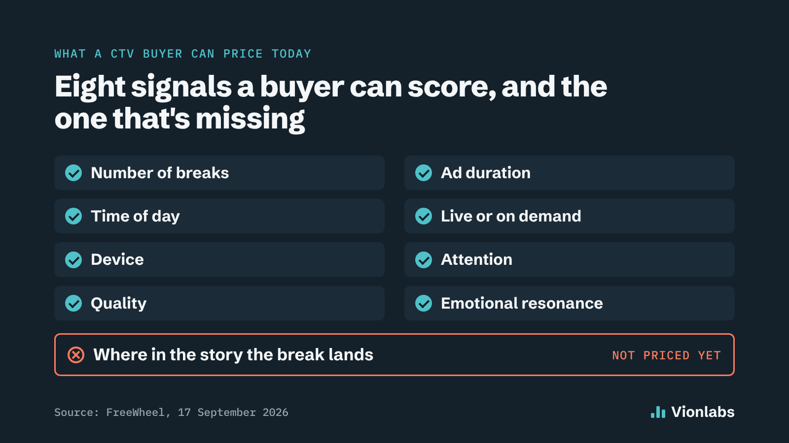

# Where the break lands

_Advertising & CTV · for Ad-funded streamers (AVOD / FAST), Broadcasters, News broadcasters, Ad-tech partners_

**An ad break should land where the story pauses, not where the clock says. CTV has started to price ad load, attention and emotional intensity. Nobody prices where in the story the break lands, and that is the part the viewer actually feels.**

## Why now

Ad loads on the big US ad tiers rose about 18% between January and August, and ad tiers and FAST channels keep putting breaks into films and back catalogue that were never written for them. In September FreeWheel began selling attention and emotional resonance as buying signals; its own research found a lighter ad load lifted unaided recall from 26% to 41%. Peer39 says about 60% of CTV bid requests carry no usable programme-level signal, and no standard field says where in the story a break falls.

## Questions the series answers

- What does a badly placed break cost: recall, drop-off, how people feel about the brand?
- How do break points get made today for content that was never written with act breaks?
- Why is a cliffhanger break on network TV different from a mid-scene break in a film?
- Where does placement matter most: news, kids, slow-burn drama?
- What would it take for narrative position to become a signal buyers pay for?

## What Vionlabs brings

Ad-Break Creation and Contextual Ad-Breaks; the SDVI ad-break detection demo on Rally (with Accurate.Video) shown at IBC; SeaOvers and i-CABLE going live in 30 days; scene-level emotion curves that show where a story pauses.

## Get before publishing

- One before/after example of break placement on a real title, cleared with the rights holder
- An accuracy or time-saved number for ad-break detection that sales is happy to publish
- Where the '46% less churn' figure on vionlabs.com comes from (the AWS listing says 64%): method and customer, before anyone quotes it
- What we may say publicly about the i-CABLE deployment beyond 'live in 30 days'
- Arash to confirm the webinar anecdote reads the way he said it

## Events

- The TV of Tomorrow Show, San Francisco (2–3 Dec)
- The Future of TV Advertising Global, London (8–9 Dec)

## Series plan

1. **The most expensive second in streaming is the one before the break** (LinkedIn article, Industry Trend Commentary)
2. **Ad minutes per hour rose 18% this year. Every extra minute has to land somewhere.** (Text, Industry Trend Commentary)
3. **How a machine finds the place where a story pauses** (Carousel, Product & AI Insight)
4. **Network TV writes its breaks into the script. Films never had them.** (Text, Opinion / Contrarian Take)
5. **The shot that panned into darkness (Arash voice note)** (Text, Founder POV / Build Lessons)

## Evidence

- [FreeWheel brings attention, quality and emotional resonance signals to CTV buying](https://www.nasdaq.com/press-release/freewheel-brings-attention-quality-and-emotional-resonance-signals-ctv-buying-2026-09) (2026-09-17)
- [More ads cut streaming brand recall from 41% to 26% (FreeWheel)](https://ppc.land/more-ads-cut-streaming-brand-recall-from-41-to-26-freewheel-finds/) (2026-09-15)
- [Peer39 CTV Truths report, Q1 2026](https://insights.peer39.com/ctv-truths-report-q1-2026) (2026)
- [Nine deploys Bitmovin AI Scene Analysis](https://www.broadbandtvnews.com/2026/09/11/nine-deploys-bitmovin-ai-scene-analysis-for-vod-workflows/) (2026-09-11)
- [Wurl launches Content Intelligence Platform](https://www.advanced-television.com/2026/09/15/wurl-launches-content-intelligence-platform/) (2026-09-15)

## From the Content Radar

- 2026-W43 gap: Where the break lands in the story
- 2026-W43 gap: The signal at the source
- 2026-W43 theme: Scene-level context moves into CTV buying
- Ideas 2026-W43-04, -05 and -11

---

# The pack (written 2026-10-20)

Five pieces for 24 Nov to 8 Dec, timed to land before The TV of Tomorrow Show and The Future of TV Advertising Global. The long read is final: fact-checked, rewritten for human prose, with sources linked inline and a cover. Three facts still need a look (marked check). Thu 26 Nov is US Thanksgiving: fine for a European feed, or move that post to Wed 25 Nov.

## The most expensive second in streaming is the one before the break

_ad-breaks-01 · Tue 24 Nov · LinkedIn article · Industry Trend Commentary_

*CTV now prices ad load, attention and emotion. Where a break lands in the story still goes unmeasured, and that's the part viewers feel.*

We price almost everything about a streaming ad break except the part viewers feel most: where it lands in the story.

You know the moment. You're an hour into a thriller, the detective has just pushed the door open, and the screen cuts to an ad for car insurance.

The rest of the break is getting priced. In September, [FreeWheel started selling attention, quality and emotional resonance](https://www.nasdaq.com/press-release/freewheel-brings-attention-quality-and-emotional-resonance-signals-ctv-buying-2026-09) as signals for CTV buying.

Its scores take in the number of breaks, how long the ads run, the time of day, live or on demand, and the device. A couple of years ago most of that wasn't priced at all, so this is real progress.

Every one of those inputs describes how much interruption there is. To a buyer, a break at the end of a scene and a break in the middle of a reveal still look the same: one break, two minutes.

## Ad loads are rising

Ad tiers are carrying more ads this year. Across the big US services, [Ampere](https://www.androidauthority.com/streaming-services-more-ads-2026-3708866/) puts the average up about 18% between January and August.

Paramount+ went from 7.9 to 9.0 minutes an hour. Netflix is still the lightest at about 2.4, and Prime Video was the only major service to cut.

Each of those extra minutes has to go somewhere in a story. Network dramas make that easy, because the writers build the act breaks into the script. Films and older catalogue titles were never written that way, so somebody has to decide where they pause.

Usually that's an editor scrubbing through the timeline, or a rule that looks for black frames and silence. Rules like that miss a lot in film. [Amazon's own documentation](https://docs.aws.amazon.com/rekognition/latest/dg/segments.html) says black frames with audio over them, such as fade-outs and voice-overs, are treated as content and skipped.

Doing it by hand is slow. When Nine moved Stan's catalogue onto [Bitmovin's scene analysis](https://senalnews.com/en/content/nine-entertainment-deploys-bitmovins-ai-scene-analysis-on-stan-to-boost-catalog-monetization) in September, it said approving ad placements had taken a lot of manual work before.

## What the research tells us

On how much advertising people will accept, the evidence is fairly strong, although most of it comes from FreeWheel and its partners:

- In a FreeWheel study with MediaScience, [reported by PPC Land](https://ppc.land/more-ads-cut-streaming-brand-recall-from-41-to-26-freewheel-finds/), unaided recall among 436 viewers was 41% in a lightly loaded programme and 26% next to nine minutes of ads per half hour.
- FreeWheel and Mediaprobe found that six minutes of ads an hour delivered 89% higher recall than twelve.

On whether the ad fits the content, the evidence is growing:

- [Wurl and TVision](https://www.businesswire.com/news/home/20250731423150/en) found attention rose from 27% to 66% of a 30-second ad when its emotion matched the content's, across more than 50 campaigns. Wurl sells emotion matching, so this is a vendor study.
- [FreeWheel's VX Lab](https://www.freewheel.com/wp-content/uploads/2025/09/FreeWheel_VX_Lab_Maximizing_Brand_Recall_Report.pdf) found recall about 20% higher when programme and ad shared one of their top three keywords, and up to 38% higher when the top keyword matched.

On where the break sits in the story, there is very little. I couldn't find an industry study comparing a mid-scene break with one at a natural pause, on recall or on drop-off.

The closest is older academic work. [Wang and Calder](https://www.kellogg.northwestern.edu/academics-research/research/detail/2006/media-trasportation-and-advertising/) found that being absorbed in a story can help an ad, but that an ad which intrudes on the experience loses out.

## The case for the break

The best argument against me comes from research I like. Across six studies, [Nelson, Meyvis and Galak](https://ideas.repec.org/a/oup/jconrs/doi10.1086-597030.html) found that commercial breaks can make a programme more enjoyable, because the pause stops us getting used to it.

YouTube is betting on position too, in its own way. Its [Peak Points pilot](https://9to5google.com/2025/05/15/youtube-ads-gemini-peak-points-placement/), announced in May 2025, uses Gemini to place an ad right after a peak moment, such as a marriage proposal. I haven't seen any published results yet.

So I accept that a break can help a show. Network TV has used the cliffhanger break on purpose for decades, and it works because the writers built the tension to carry viewers through the ads and back.

What worries me is the break nobody designed. It's the one dropped mid-conversation because the clock reached 14:00, or in the middle of a long, quiet scene because the picture went dark.

The enjoyment effect has limits too. It disappeared for programmes that don't lead viewers to adapt, and the authors guessed at the time that very fast-paced shows probably don't benefit either.

News raises the stakes further. News and commentary channels grew faster than any other major FAST genre over the past year, up 52.9% by [Gracenote's count](https://www.newscaststudio.com/2026/08/20/fast-sports-programming-growth-outpaces-channel-expansion-gracenote-finds/), and news is where the content next to a break matters most.

## How we look for the pause

We've worked on this at Vionlabs for years. Our ad-break detection combines four models: one that spots black frames and avoids cutting into speech, one that follows the flow of the story, one that finds scene boundaries, and one that compares how similar the shots are.

The more of them agree on a spot, the higher it's rated (excellent, good or passable). An editor then reviews a ranked shortlist instead of the whole film.

It still makes mistakes. In [a webinar with SDVI](https://www.vionlabs.com/news/accelerating-ad-breaks-detection-and-insertion-webinar-with-sdvi) this summer I described one: a shot that pans into darkness can look like a black frame to the model, so it gets flagged as a break.

That's why we built it for a person to check the result. [SDVI has shown our detection](https://sdvi.com/about-us/press-releases/sdvi-to-showcase-next-generation-rally-platform-and-new-technology-integrations-at-ibc2026/) on its Rally platform with Codemill's Accurate.Video, where editors validate each suggested break frame by frame.

With our partner SeaOvers, [i-CABLE in Hong Kong](https://www.vionlabs.com/news/vionlabs-and-seaovers-announce-partnership-to-elevate-ad-supported-streaming-with-ai-i-cable-launches-first-deployment-in-asia) went from signed contract to live in 30 days.

We're not alone in this. [Bitmovin](https://bitmovin.com/blog/ai-ad-placement-score-scene-level-streaming/) describes an ad opportunity score for each scene boundary, based on the pacing and tension of the scenes on either side. I read that as a good sign that publishers want breaks that respect the story.

## The missing signal

Contextual data is finally moving through CTV. [Wurl](https://www.mediapost.com/publications/article/418319/) now adds it to bid requests before they reach the buyer, while [FreeWheel](https://www.businesswire.com/news/home/20260414782359/en/) and [Anoki](https://www.businesswire.com/news/home/20251209200641/en/) describe the tone of each scene.

Even so, [Peer39](https://insights.peer39.com/ctv-truths-report-q1-2026) finds that about 60% of CTV bid requests carry no usable signal about the programme at all.

I couldn't find anything in the industry's ad standards that records where in the story a break falls.

Emotion travels today to describe the scene before an ad, so that a matching ad can be picked. Where the break itself sits is taken as given.

That's the signal I think we should add next. **A break-quality score, created where the content lives and carried with the cue point, would let buyers pay more for breaks that keep the story intact, and give publishers a way to prove it.**

## Where I'd start

If you run an ad tier or a FAST channel, these tests are cheap:

- Drop-off in the 30 seconds after a break, split by whether it landed at a scene boundary or mid-scene
- Completion of the first ad in the pod, with the same split
- How often people finish a title when its breaks follow the story, compared with breaks on a timer

And if you sell CTV inventory, I'd like to hear from you. Would you charge more for a break you could prove lands at a natural pause, or will buyers never pay for position?

**Sources:** [FreeWheel brings attention, quality and emotional resonance signals to CTV buying](https://www.nasdaq.com/press-release/freewheel-brings-attention-quality-and-emotional-resonance-signals-ctv-buying-2026-09) (2026-09-17); [Streaming services are showing more ads in 2026 (Ampere data, Android Authority)](https://www.androidauthority.com/streaming-services-more-ads-2026-3708866/) (2026-09); [More ads cut streaming brand recall from 41% to 26% (FreeWheel + MediaScience)](https://ppc.land/more-ads-cut-streaming-brand-recall-from-41-to-26-freewheel-finds/) (2026-09-15); [Wurl and TVision: emotion alignment and ad attention on streaming TV](https://www.businesswire.com/news/home/20250731423150/en) (2025-07-31); [Wang & Calder, Media Transportation and Advertising (Journal of Consumer Research)](https://www.kellogg.northwestern.edu/academics-research/research/detail/2006/media-trasportation-and-advertising/) (2006); [Nelson, Meyvis & Galak, Enhancing the television-viewing experience through commercial interruptions (JCR)](https://ideas.repec.org/a/oup/jconrs/doi10.1086-597030.html) (2009); [YouTube's Peak Points uses Gemini to place ads after peak moments (9to5Google)](https://9to5google.com/2025/05/15/youtube-ads-gemini-peak-points-placement/) (2025-05-15); [Amazon Rekognition: detecting video segments](https://docs.aws.amazon.com/rekognition/latest/dg/segments.html) (current docs); [Nine deploys Bitmovin AI Scene Analysis on Stan (Señal News)](https://senalnews.com/en/content/nine-entertainment-deploys-bitmovins-ai-scene-analysis-on-stan-to-boost-catalog-monetization) (2026-09-14); [Bitmovin: AI ad placement score at scene level](https://bitmovin.com/blog/ai-ad-placement-score-scene-level-streaming/) (2026-Q1); [FAST sports growth outpaces channel expansion (Gracenote via NewscastStudio)](https://www.newscaststudio.com/2026/08/20/fast-sports-programming-growth-outpaces-channel-expansion-gracenote-finds/) (2026-08-20); [Accelerating ad-break detection and insertion: webinar with SDVI](https://www.vionlabs.com/news/accelerating-ad-breaks-detection-and-insertion-webinar-with-sdvi) (2026-08-19); [SDVI at IBC2026: Rally platform with Vionlabs and Accurate.Video](https://sdvi.com/about-us/press-releases/sdvi-to-showcase-next-generation-rally-platform-and-new-technology-integrations-at-ibc2026/) (2026-09); [Vionlabs and SeaOvers partnership; i-CABLE first deployment](https://www.vionlabs.com/news/vionlabs-and-seaovers-announce-partnership-to-elevate-ad-supported-streaming-with-ai-i-cable-launches-first-deployment-in-asia) (2025-09-11); [FreeWheel Context Engine (Business Wire)](https://www.businesswire.com/news/home/20260414782359/en/) (2026-04-14); [Anoki ContextIQ via Index Exchange (Business Wire)](https://www.businesswire.com/news/home/20251209200641/en) (2025-12-09); [IAB Tech Lab defines six core CTV ad formats (NewscastStudio)](https://www.newscaststudio.com/2025/12/12/iab-tech-lab-defines-six-core-ad-formats-in-new-ctv-portfolio) (2025-12-12); [IAB Tech Lab: OpenRTB updates for your 2026 roadmap](https://iabtechlab.com/essential-openrtb-updates-you-cant-ignore-for-your-2026-roadmap/) (2026); [Wurl launches Content Intelligence Platform (MediaPost)](https://www.mediapost.com/publications/article/418319/) (2026-09-15); [Peer39 CTV Truths report, Q1 2026](https://insights.peer39.com/ctv-truths-report-q1-2026) (2026-Q1); [FreeWheel VX Lab: Maximizing Brand Recall Through Contextual Alignment](https://www.freewheel.com/wp-content/uploads/2025/09/FreeWheel_VX_Lab_Maximizing_Brand_Recall_Report.pdf) (2025-09)

## Ad minutes per hour rose 18% this year. Every extra minute has to land somewhere.

_ad-breaks-02 · Thu 26 Nov · Text · Industry Trend Commentary_

Ad minutes per hour on the big US ad tiers rose about 18% between January and August, according to Ampere.

Paramount+ went from 7.9 to 9.0 minutes an hour. Netflix is still the lightest at around 2.4, and Prime Video was the only major service to cut.

I understand why it's happening. Ad tiers are where the growth is, and Netflix now says its ad tier reaches more than 250 million monthly viewers [check], so there is more inventory to sell every month.

All of those extra minutes have to land somewhere in a story. Network dramas have act breaks written into the script. Films and older catalogue titles don't, so their breaks go where the clock says or where the picture happens to go black.

The research on load is fairly clear: lighter loads are remembered better. Research on where in the story a break should go barely exists, and I'd want that gap closed before anyone adds the next minute.

I wrote a longer piece on where breaks land and why nobody prices it yet. The link is in the comments.

If you run an ad tier: do you know your drop-off in the 30 seconds after a break, split by where in the scene it landed?

**Sources:** [Streaming services are showing more ads in 2026 (Ampere data, Android Authority)](https://www.androidauthority.com/streaming-services-more-ads-2026-3708866/) (2026-09); [Streamers add ad minutes: do viewers mind? (MediaPost)](https://www.mediapost.com/publications/article/417824/streamers-add-ad-minutes-do-viewers-mind.html) (2026-09-14); [Netflix ad tier passes 250M monthly active viewers (Streaming Media Blog)](https://www.streamingmediablog.com/2026/05/netflix-adtier-150million.html) (2026-05); [More ads cut streaming brand recall from 41% to 26% (FreeWheel + MediaScience)](https://ppc.land/more-ads-cut-streaming-brand-recall-from-41-to-26-freewheel-finds/) (2026-09-15)

## How a machine finds the place where a story pauses

_ad-breaks-03 · Tue 1 Dec · Carousel · Product & AI Insight_

**Hook / slide 1:** A two-minute break costs the same wherever it lands in the story, and viewers feel the difference.

**Pillar:** Product & AI Insight

**Slides** (1080x1350 portrait, the series template; use the cover's tension curve as the recurring visual)

1. "A two-minute break is priced the same wherever it lands." Designer: the tension curve from the article cover, with one break in a valley and one on the climb to a reveal.
2. "Ad loads on US ad tiers: up about 18% this year." Designer: big stat card. Source line: Ampere, Jan–Aug 2026.
3. "Network TV writes its breaks into the script. Films and older catalogue titles never had them." Designer: split slide, a script page with ACT BREAK on the left, an unmarked film strip on the right.
4. "The usual shortcut is to look for a black frame or a silence, which misses fades and voice-overs." Designer: a waveform under a black frame, with the audio still running.
5. "We use four models instead of one rule." Designer: four horizontal lanes labelled black frames & speech, story flow, scene boundaries, shot similarity.
6. "The more models agree, the better the rating: excellent, good or passable." Designer: the four lanes lighting up at one point on the timeline, with the rating as a badge.
7. "Every candidate comes back with a rank score and content tags." Designer: a card with timestamp, rank, and the mood before and after.
8. "People check the suggestions frame by frame." Designer: an editor's review view; caption "Shown with SDVI Rally and Accurate.Video".
9. "CTV now prices load, duration, attention and emotion. Position has no column yet." Designer: a pricing matrix with the last column, "Where in the story", left empty.
10. "Where would you pay more for a break?" Designer: closing slide with the Vionlabs mark and "Long read linked in the post".

**Data to visualise**
- Big stat card: +18% ad minutes per hour (slide 2)
- Optional slope chart after slide 2: minutes per hour in January and August 2026 for Paramount+ (7.87 to 9.01) and Netflix (1.40 to 2.44), the two services with confirmed figures for both months
- Pricing matrix (slide 9): the inputs in FreeWheel's September release, with an empty column for position

**Closing takeaway / soft CTA:** Position is the one thing about a break nobody measures yet. Read the long piece and tell us which break you'd pay more for.

**Caption (about 80 words)**
CTV buyers can now price ad load, attention and emotion, which is a big step. A two-minute break in the middle of a reveal still counts the same as one at the end of a scene, though.

This is how we find the places where a story actually pauses: four models, a rating for each candidate break based on how many of them agree, and people who check the suggestions frame by frame.

Which would you rather have on your ad tier: fewer breaks, or the same number in better places?

**Sources:** [Streaming services are showing more ads in 2026 (Ampere data, Android Authority)](https://www.androidauthority.com/streaming-services-more-ads-2026-3708866/) (2026-09); [Amazon Rekognition: detecting video segments](https://docs.aws.amazon.com/rekognition/latest/dg/segments.html) (current docs); [Vionlabs Ad-Break Creation on AWS Marketplace](https://aws.amazon.com/marketplace/pp/prodview-xmfajvapsnwsg) (undated); [SDVI at IBC2026: Rally platform with Vionlabs and Accurate.Video](https://sdvi.com/about-us/press-releases/sdvi-to-showcase-next-generation-rally-platform-and-new-technology-integrations-at-ibc2026/) (2026-09); [FreeWheel brings attention, quality and emotional resonance signals to CTV buying](https://www.nasdaq.com/press-release/freewheel-brings-attention-quality-and-emotional-resonance-signals-ctv-buying-2026-09) (2026-09-17); [SDVI partner page: Vionlabs ad-break detection models](https://sdvi.com/?p=9628) (undated)

## Network TV writes its breaks into the script. Films never had them.

_ad-breaks-04 · Thu 3 Dec · Text · Opinion / Contrarian Take_

Network TV writes its ad breaks into the script. Films never had them, and ad tiers are putting breaks into them anyway.

I want to be fair to the break. Across six studies, Nelson, Meyvis and Galak found that commercial breaks can make a show more enjoyable, because the interruption stops us getting used to it. A cliffhanger before the ads works because a writer chose the moment and built the tension to carry you through the break and back.

A film on an ad tier has none of that, and neither does a Korean drama on a FAST channel or a 2009 title from the back catalogue. Their breaks go where the clock says, or where a rule finds a black frame, which is sometimes a natural pause and sometimes the middle of a sentence.

The same research found that the effect disappeared for programmes that don't lead viewers to adapt, so whether a break helps depends on the story around it.

What would you rather have on your ad tier: fewer breaks, or the same number in better places?

**Sources:** [Nelson, Meyvis & Galak, Enhancing the television-viewing experience through commercial interruptions (JCR)](https://ideas.repec.org/a/oup/jconrs/doi10.1086-597030.html) (2009)

## The shot that panned into darkness: an ad break our model gets wrong

_ad-breaks-05 · Tue 8 Dec · Text · Founder POV / Build Lessons_

Our ad-break model has a weakness I talked about in a webinar with SDVI this summer: a shot that pans into darkness can look like a black frame to it, and it flags the moment as a break [check].

[Arash: a line or two on a real example you can share, and why a person would never have put a break there.]

Black frames are one of the oldest cues for finding a break. In a film the picture can go dark at the tensest point of a scene, though, so that cue can't be trusted on its own.

So the model combines four: black frames and speech, story flow, scene boundaries and shot similarity. A candidate is rated excellent, good or passable depending on how many of them agree, and people check the suggestions frame by frame in Accurate.Video.

[Arash: one line on why you kept a person in the loop instead of going fully automatic.]

[Team: if Arash is at The Future of TV Advertising Global (8–9 Dec), add "I'm in London this week talking about exactly this." Otherwise cut.]

What's the worst-placed ad break you've ever sat through?

**Sources:** [Accelerating ad-break detection and insertion: webinar with SDVI](https://www.vionlabs.com/news/accelerating-ad-breaks-detection-and-insertion-webinar-with-sdvi) (2026-08-19); [SDVI partner page: Vionlabs ad-break detection models](https://sdvi.com/?p=9628) (undated)

## Voice note prompts for Arash

- The shot that panned into darkness, from the SDVI webinar: is that how you'd put it, and do you have a real example you can share?
- Why did we keep a person in the loop for ad breaks instead of going fully automatic?
- What did it take to get i-CABLE live in 30 days? Anything from that project we can say in public?
- An ad-sales person tells you interruptions don't hurt and the peak is premium inventory. What do you say?
- Where does placement matter most to you: news, kids, slow-burn drama? Give one example.

## Fact-check before posting

| Claim | Source | Status |
| --- | --- | --- |
| FreeWheel brings attention, quality and emotional resonance signals into CTV buying; scoring uses number of ad breaks, ad duration, time of day, live or on-demand, device type | [FreeWheel release (Nasdaq; also MarTech Series)](https://www.nasdaq.com/press-release/freewheel-brings-attention-quality-and-emotional-resonance-signals-ctv-buying-2026-09) 2026-09-17 | confirmed |
| Six minutes of ads an hour delivered 89% higher recall than twelve (FreeWheel + Mediaprobe; a relative lift, method not public) | [MarTech Series and trading-treff.de, from the FreeWheel release](https://www.nasdaq.com/press-release/freewheel-brings-attention-quality-and-emotional-resonance-signals-ctv-buying-2026-09) 2026-09-17 | confirmed |
| 436 participants; unaided recall 41% in a lightly loaded programme vs 26% alongside nine minutes of commercials per half hour (FreeWheel + MediaScience) | [ppc.land (only source found)](https://ppc.land/more-ads-cut-streaming-brand-recall-from-41-to-26-freewheel-finds/) 2026-09-15 | check |
| Ad minutes per hour on major US ad tiers up about 18%, Jan to Aug 2026; Paramount+ 7.87 to 9.01; Netflix 1.40 to 2.44; Prime Video the only major service to cut | [Ampere via Android Authority, MediaPost, eMarketer](https://www.androidauthority.com/streaming-services-more-ads-2026-3708866/) 2026-09 | confirmed |
| Hulu's January figure (6.78) was not found anywhere, so Hulu was dropped from the pack | [Fact-check note](https://www.mediapost.com/publications/article/418721/) 2026-09 | unconfirmed |
| Netflix ad tier reaches more than 250 million monthly active viewers (Netflix's own definition), used in the ad-load post | [Streaming Media Blog](https://www.streamingmediablog.com/2026/05/netflix-adtier-150million.html) 2026-05 | check |
| Attention rose from 27% to 66% of a 30-second ad when ad and content emotion matched; 50+ campaigns (Wurl is a vendor of emotion matching) | [Business Wire; Wurl report PDF](https://www.businesswire.com/news/home/20250731423150/en) 2025-07-31 | confirmed |
| Recall about 20% higher when programme and ad share one of their top three keywords; up to 38% when the top keyword matches (FreeWheel's own research, measured by Mediaprobe) | [FreeWheel VX Lab report and blog](https://www.freewheel.com/wp-content/uploads/2025/09/FreeWheel_VX_Lab_Maximizing_Brand_Recall_Report.pdf) 2025-09 | confirmed |
| Wang & Calder (JCR 33(2), 2006): transportation can help ads; intrusion of the ad into the experience mediates the negative effect | [Kellogg research page; JCR abstract](https://www.kellogg.northwestern.edu/academics-research/research/detail/2006/media-trasportation-and-advertising/) 2006 | confirmed |
| Nelson, Meyvis & Galak (JCR 36(2), 2009): six studies; commercial breaks made programmes more enjoyable by disrupting adaptation; eliminated for people less prone to adaptation and for programmes that don't lead to adaptation. 'Fast-paced shows' was the authors' guess in 2009 press coverage. | [RePEc; ScienceDaily](https://ideas.repec.org/a/oup/jconrs/doi10.1086-597030.html) 2009 | confirmed |
| YouTube Peak Points: announced May 2025 as a pilot; Gemini places the ad right after a peak moment (proposal example); no published results found | [9to5Google; Euronews; PCWorld](https://9to5google.com/2025/05/15/youtube-ads-gemini-peak-points-placement/) 2025-05-15 | confirmed |
| Rekognition: 'Black frames that contain audio (such as fade outs or voice-overs) are considered as content and not returned' | [AWS documentation (primary)](https://docs.aws.amazon.com/rekognition/latest/dg/segments.html) current docs | confirmed |
| Nine/Stan on Bitmovin AI Scene Analysis; 'ad placement approvals would have taken a lot of manual effort and time' (John Hogan; one source, and his title differs between Nine and Stan, so the article quotes Nine without a title) | [Señal News, based on Bitmovin's release](https://senalnews.com/en/content/nine-entertainment-deploys-bitmovins-ai-scene-analysis-on-stan-to-boost-catalog-monetization) 2026-09-14 | check |
| Bitmovin's ad opportunity score weighs the current and following scene's context, pacing and tension (vendor description; developer docs still list scoring as coming soon) | [Bitmovin blog](https://bitmovin.com/blog/ai-ad-placement-score-scene-level-streaming/) 2026-Q1 | confirmed |
| News and commentary had the fastest channel growth among major FAST genres, +52.9% year on year (211 channels, July 2026); 2,172 FAST channels overall | [NewscastStudio; The Desk](https://www.newscaststudio.com/2026/08/20/fast-sports-programming-growth-outpaces-channel-expansion-gracenote-finds/) 2026-08-20 | confirmed |
| Four models: Black Frame and Speech Avoidance Detector, Deep Learning Story Flow Analysis, Scene Boundary Detector, Shot-Similarity Algorithm; breaks rated excellent, good or passable by how many models agree; rank scores and content tags | [SDVI partner page; Vionlabs webinar page; AWS Marketplace](https://sdvi.com/?p=9628) 2026 | confirmed |
| Webinar anecdote: the model can treat a shot panning into darkness as a black frame and flag it as a break (search paraphrase; Arash to confirm against the recording) | [Vionlabs webinar page with SDVI](https://www.vionlabs.com/news/accelerating-ad-breaks-detection-and-insertion-webinar-with-sdvi) 2026-08-19 | check |
| SDVI showed Vionlabs ad-break detection with Accurate.Video (Validate Ad Detection mode) on Rally at NAB and IBC 2026; frame-accurate human validation (Codemill credited on the Vionlabs webinar page) | [SDVI releases; TV Technology; Vionlabs webinar page](https://sdvi.com/about-us/press-releases/sdvi-to-showcase-next-generation-rally-platform-and-new-technology-integrations-at-ibc2026/) 2026-09 | confirmed |
| i-CABLE went from signed contract to live in about 30 days (Vionlabs' own release; don't quote anyone from the 2025 release) | [Vionlabs news](https://www.vionlabs.com/news/vionlabs-and-seaovers-announce-partnership-to-elevate-ad-supported-streaming-with-ai-i-cable-launches-first-deployment-in-asia) 2025-09-11 | confirmed |
| Wurl's Content Intelligence Platform adds contextual signals to CTV bid requests before they reach DSPs | [MediaPost; Advanced Television](https://www.mediapost.com/publications/article/418319/) 2026-09-15 | confirmed |
| FreeWheel Context Engine: semantic tagging from captions; visual analysis for emotion, location, objects and scene attributes | [Business Wire; ExchangeWire](https://www.businesswire.com/news/home/20260414782359/en/) 2026-04-14 | confirmed |
| Anoki ContextIQ: scene-level tone, sentiment and subject matter through Index Marketplaces (Index Exchange) | [Business Wire; Index Exchange](https://www.businesswire.com/news/home/20251209200641/en/) 2025-12-09 | confirmed |
| IAB Tech Lab CTV Ad Portfolio: Pause, Menu, Screensaver, In-Scene, Squeezebacks, Overlays; released for public comment (final version not confirmed) | [NewscastStudio; StreamTV Insider](https://www.newscaststudio.com/2025/12/12/iab-tech-lab-defines-six-core-ad-formats-in-new-ctv-portfolio) 2025-12-12 | confirmed |
| About 60% of CTV bid requests contain no usable program-level signal (Peer39's own data) | [Peer39 report; PPC Land](https://insights.peer39.com/ctv-truths-report-q1-2026) 2026-Q1 | confirmed |
| '46% reduction in churn' (vionlabs.com) vs '64% churn for misaligned AVOD ads' (AWS listing): conflicting, method not public. Not used. | [Vionlabs AWS Marketplace listing](https://aws.amazon.com/marketplace/pp/prodview-xmfajvapsnwsg) undated | unconfirmed |

## How this was made

- Three research agents, 72 web searches in total: evidence and numbers, competitors and the CTV signal chain, and Vionlabs' public proof.
- This environment's network policy blocked every page fetch, so every fact comes from search-result summaries. Everything marked [check] needs a look at the source before posting.
- The evidence on break position itself is thin. The pack says so instead of overstating it, and leans on load, fit and the absence of a position signal.
- Bitmovin's ad opportunity score (live at Nine/Stan) undercuts any claim that nobody reads the story, so the long read names it as a sign the market wants this.
- Left out on purpose: the 46% vs 64% churn figures (conflicting, method not public), the Plex 'smarter ad breaks' line (snippet only), and any news-adjacency incident (none documented).
- No event attendance is claimed: TV of Tomorrow and The Future of TV Advertising are still Tbd in the Notion calendar.
- Verification pass on 2026-10-20: two more agents, 46 searches, checked all 22 claims in the long read against two independent sources or the primary source. Pages were still blocked, so this was done from search results.
- Corrected after the check: the VX Lab keyword figures (20% for any top-three keyword, up to 38% for the top one), the limits of the Nelson, Meyvis & Galak effect (six studies; 'fast-paced' was the authors' guess in 2009 press coverage), the webinar anecdote (a shot panning into darkness, not a dark wall), and the ad-break description (four named models, rated by agreement; 'in parallel' had no source).
- Dropped: Hulu's January ad load (not found) and the Vitrina interview as a source (a podcast page with no transcript).
- Every piece had a human-prose pass (no negative parallelism, foils, rhythm triads, kicker lines or em-dash pivots).
