# Vionlabs LinkedIn ad copy

Single-image ads, 1200×1200. Images in `png/`, sources in `ads.html`.

## ag1 · Agentic Layer · Talk to your video library

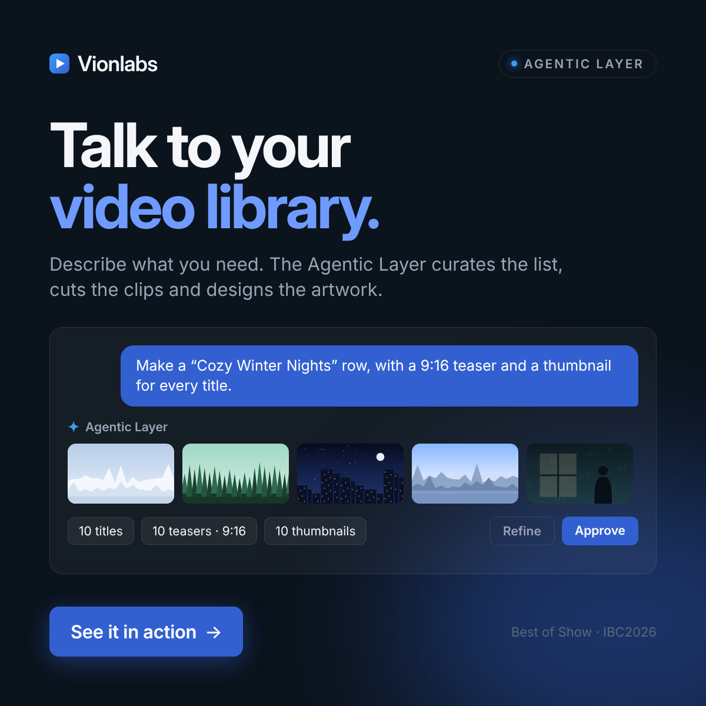

**Intro text**

> Your video library has the answers. Now you can just ask.
>
> The Vionlabs Agentic Layer curates lists, cuts clips in every ratio and creates branded thumbnails from a plain-language request, grounded in scene-level understanding of every title. Your team approves before anything goes live.

**Headline:** Talk to your video library  
**CTA button:** Request Demo  
**Audience:** Heads of content, editorial and marketing at streamers and broadcasters  
**Inspired by:** Product UI as the hero, like TwelveLabs' “Focus on the story” before/after visual

**Claims**

- Curates lists, cuts clips in every ratio, creates branded thumbnails: vionlabs.com/agentic-layer (SEO description) (On the website)
- “10 titles / 10 teasers” in the visual: UI mock (Example values)

## ag2 · Agentic Layer · Ask. Approve. Publish.

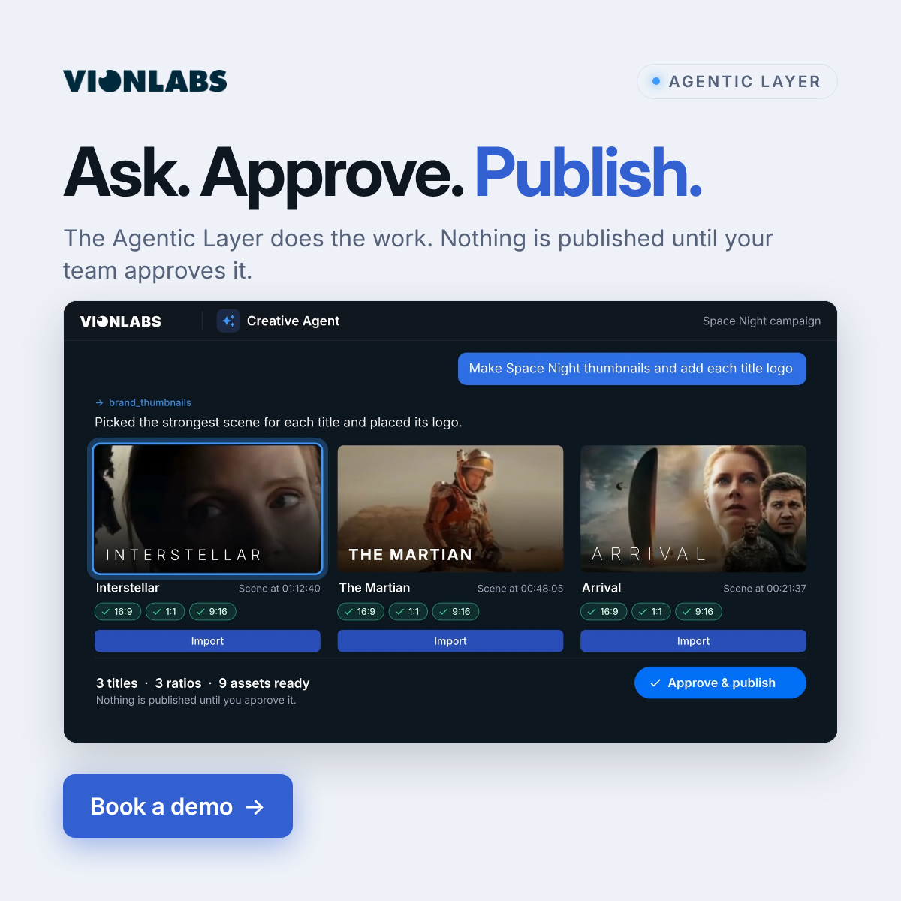

**Intro text**

> Your team knows what it wants. Getting it shouldn’t take a queue of requests.
>
> Ask the Agentic Layer for teasers, lists or artwork in plain language. It does the work, and your team reviews and publishes.

**Headline:** Ask. Approve. Publish.  
**CTA button:** Request Demo  
**Audience:** Content operations, marketing and creative leads at streamers  
**Inspired by:** Pipeline diagram with an approval step, like TwelveLabs' “Review shouldn’t be the bottleneck”

**Claims**

- “Ask. Approve. Publish.”: vionlabs.com/agentic-layer (Open Graph title) (On the website)

## ag3 · Agentic Layer · One title. Every ratio.

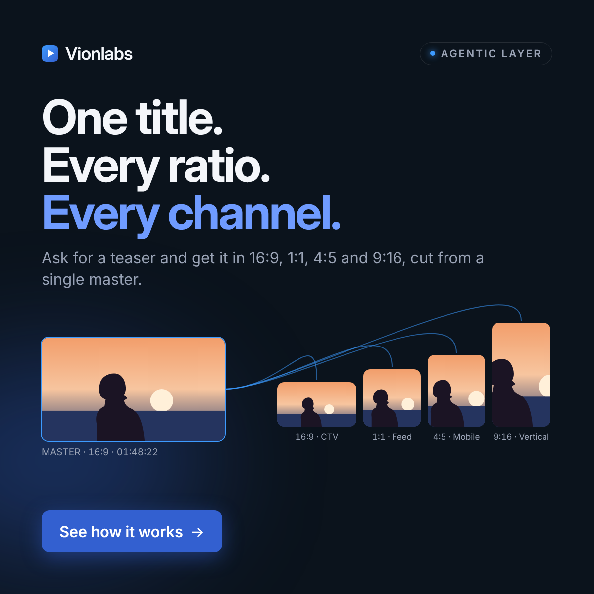

**Intro text**

> Every channel wants a different shape.
>
> Ask the Agentic Layer for a teaser and get 16:9, 1:1, 4:5 and 9:16 versions from a single master, with thumbnails to match.

**Headline:** Every ratio from one request  
**CTA button:** Learn More  
**Audience:** Social, marketing and promo teams at streamers and broadcasters  
**Inspired by:** Three-beat headline and fan-out diagram, like TwelveLabs' “One master. Five markets.”

**Claims**

- Clips in every ratio: vionlabs.com/agentic-layer; Creative Lab formats 16:9 to 9:16 (On the website)

## ag4 · Agentic Layer · Best of Show at IBC2026

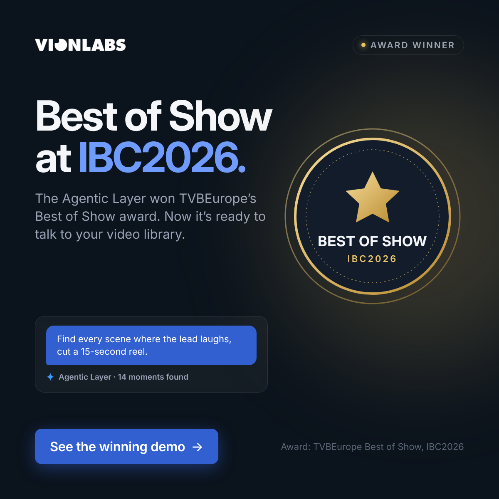

**Intro text**

> The Agentic Layer won Best of Show at IBC2026.
>
> It lets media teams talk to their video library. Search by mood, moment or character, then get clips, lists and artwork back, ready to approve.

**Headline:** IBC2026 Best of Show: the Agentic Layer  
**CTA button:** Request Demo  
**Audience:** Broad media and entertainment decision-makers; retarget IBC visitors  
**Inspired by:** Vionlabs original: award as social proof

**Claims**

- TVBEurope Best of Show award at IBC2026: tvbeurope.com, 14 Sep 2026 (Check before launch)
- Medal artwork: Stand-in; swap for TVBEurope's official winner badge (Check before launch)

## cu1 · Curio · How titles feel

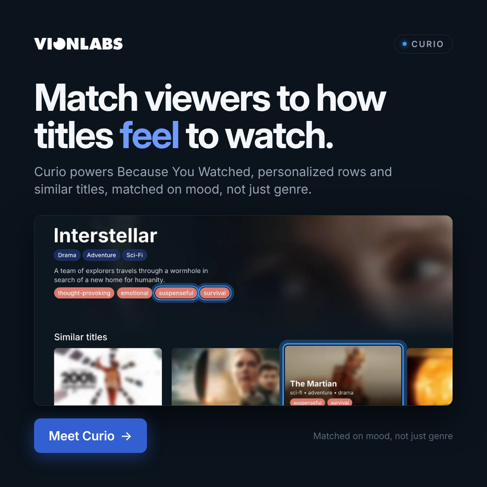

**Intro text**

> Two titles can share a genre and feel nothing alike.
>
> Curio recommends on how titles feel to watch, so Because You Watched, personalized rows and similar titles keep viewers in the mood they came for.

**Headline:** Recommendations matched on how titles feel  
**CTA button:** Learn More  
**Audience:** Product, personalization and growth leads at streaming services  
**Inspired by:** Annotated side-by-side, like TwelveLabs' “Focus on the story”

**Claims**

- Matches viewers to how titles feel to watch; Because You Watched, personalized rows, similar titles: vionlabs.com/curio (SEO description) (On the website)

## cu2 · Curio · Recommend before the first view

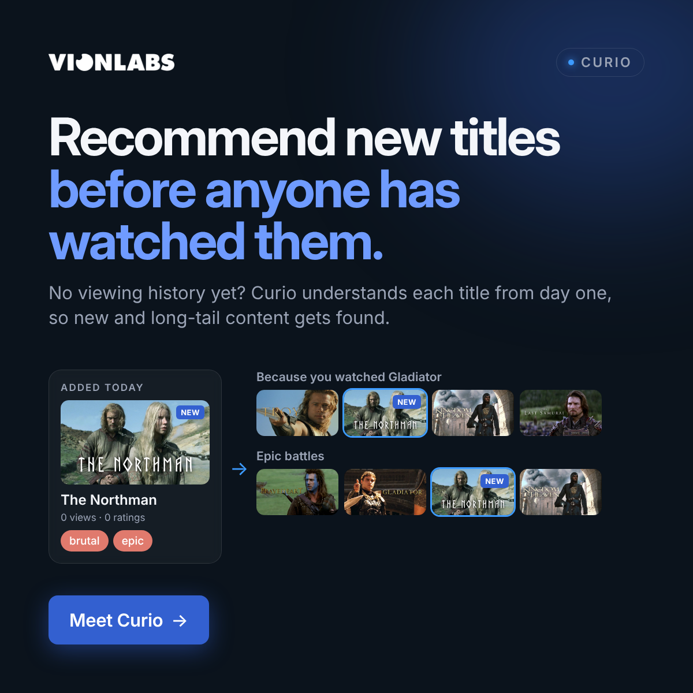

**Intro text**

> New titles have no viewing history. That’s exactly when they need recommending.
>
> Curio understands every title from day one, so new releases and long-tail content show up in the right rows from the start.

**Headline:** Recommend new titles from day one  
**CTA button:** Learn More  
**Audience:** Product, personalization and content-acquisition leads at streamers  
**Inspired by:** Problem-first hook, like TwelveLabs' “Detection tools were supposed to…” intro

**Claims**

- Handles new and long-tail titles without viewing history: Curio launch press release (Check before launch)

## cu3 · Curio · 1M+ analyzed assets

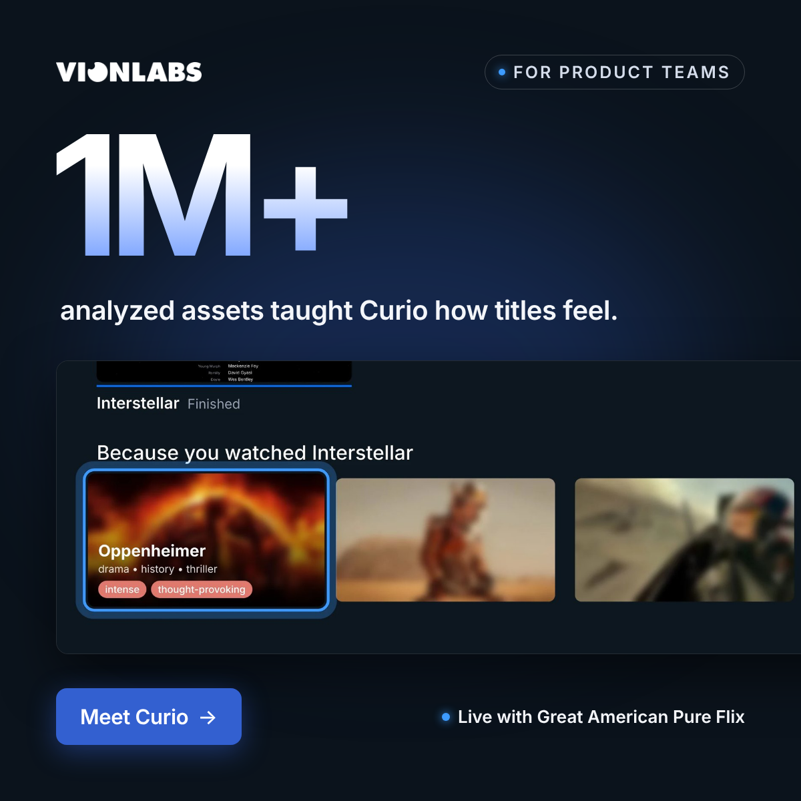

**Intro text**

> Curio is live with Great American Pure Flix.
>
> Its recommendations come from embeddings learned from more than 1,000,000 analyzed assets, powering Because You Watched, personalized rows and similar titles.

**Headline:** Curio: AI recommendations, now live  
**CTA button:** Learn More  
**Audience:** Product and personalization leads at streamers  
**Inspired by:** Big-number hero, like TwelveLabs' “Review a 2-hour master in 12 minutes”

**Claims**

- Live with Great American Pure Flix: vionlabs.com/curio (SEO description) (On the website)
- Embeddings learned from 1,000,000+ analyzed assets: Curio launch press release (Check before launch)

## ed1 · Editorial Lab · 90%+ of your catalog

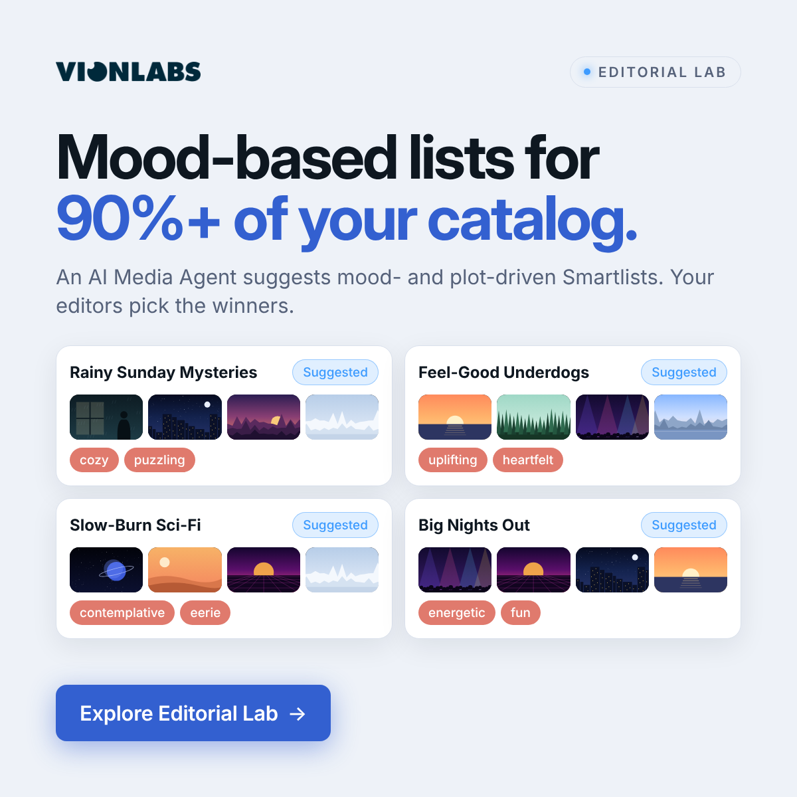

**Intro text**

> Your editors can’t hand-curate a whole catalog. They don’t have to.
>
> Editorial Lab’s AI Media Agent suggests mood- and plot-driven Smartlists covering 90%+ of your catalog. Your team picks what goes live.

**Headline:** Mood-based lists for 90%+ of your catalog  
**CTA button:** Learn More  
**Audience:** Editorial, curation and programming teams at streamers  
**Inspired by:** Stat headline over product UI

**Claims**

- Mood-based lists covering 90%+ of your catalog: vionlabs.com homepage and /editorial-lab (Check before launch)
- List names and moods in the visual: UI mock (Example values)

## ed2 · Editorial Lab · Hidden content is hidden revenue

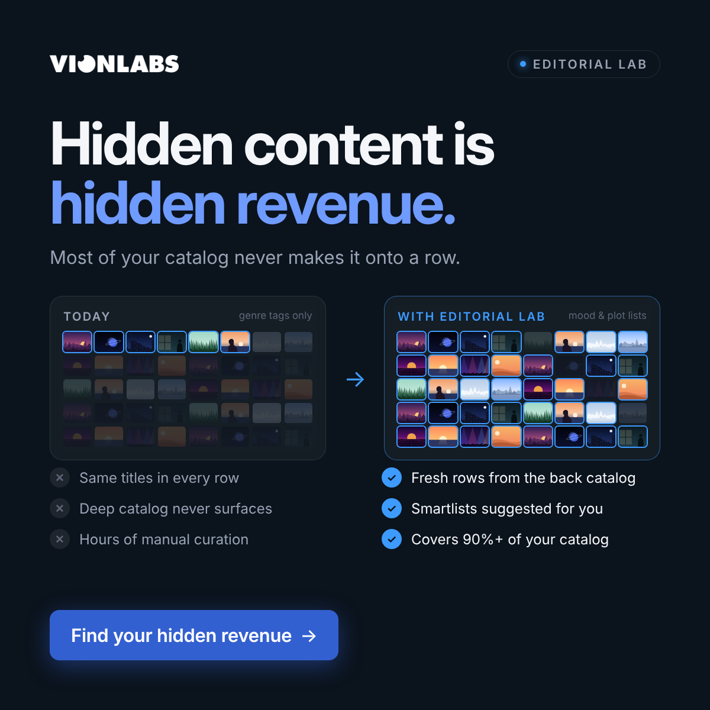

**Intro text**

> The titles nobody finds are titles you paid for and never earn from.
>
> Editorial Lab surfaces your deep catalog in fresh mood- and plot-driven rows, so more of your library gets watched.

**Headline:** Hidden content is hidden revenue  
**CTA button:** Learn More  
**Audience:** Content strategy, programming and revenue leads at streamers  
**Inspired by:** Before → after with ✕ / ✓ lists, like TwelveLabs' “Review a 2-hour master in 12 minutes”

**Claims**

- “Hidden content is hidden revenue”: Vionlabs blog headline (On the website)
- Covers 90%+ of your catalog: vionlabs.com/editorial-lab (Check before launch)

## cr1 · Creative Lab · The visual it deserves

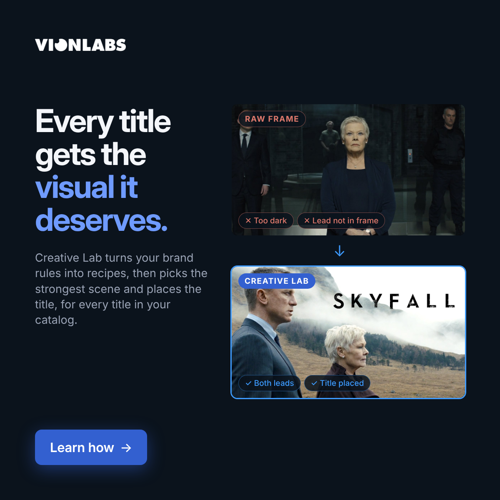

**Intro text**

> A random frame makes a bad first impression.
>
> Creative Lab turns your brand rules into recipes, then creates on-brand thumbnails, preview clips and shorts for every title in your catalog.

**Headline:** On-brand thumbnails for every title  
**CTA button:** Learn More  
**Audience:** Creative, brand and marketing teams at streamers and broadcasters  
**Inspired by:** Annotated before/after imagery, like TwelveLabs' “Focus on the story. Not the edit.”

**Claims**

- “Every asset gets the visual it deserves”; thumbnails and preview clips at scale: vionlabs.com/creative-lab (SEO description) (On the website)
- Recipes (mood, keywords, characters, key moments): Creative Lab press release, 9 Sep 2025 (On the website)

## cr2 · Creative Lab · Write the recipe once

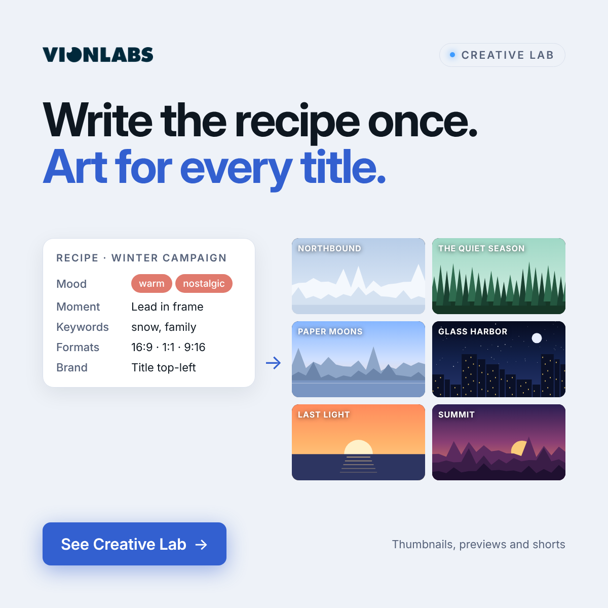

**Intro text**

> Set the mood, the moment and the format once.
>
> Creative Lab applies your recipe across the catalog and generates thumbnails, previews and shorts from 16:9 to 9:16, ready for your team to review.

**Headline:** One recipe. Art for every title.  
**CTA button:** Request Demo  
**Audience:** Creative, brand and marketing teams at streamers  
**Inspired by:** Input → output diagram, like TwelveLabs' “Generation is automated” pipeline

**Claims**

- Recipes; formats 16:9 to 9:16: Creative Lab press release, 9 Sep 2025 (On the website)
- Recipe fields and titles in the visual: UI mock (Example values)

## op1 · Operations Lab · Skip Intro on every episode

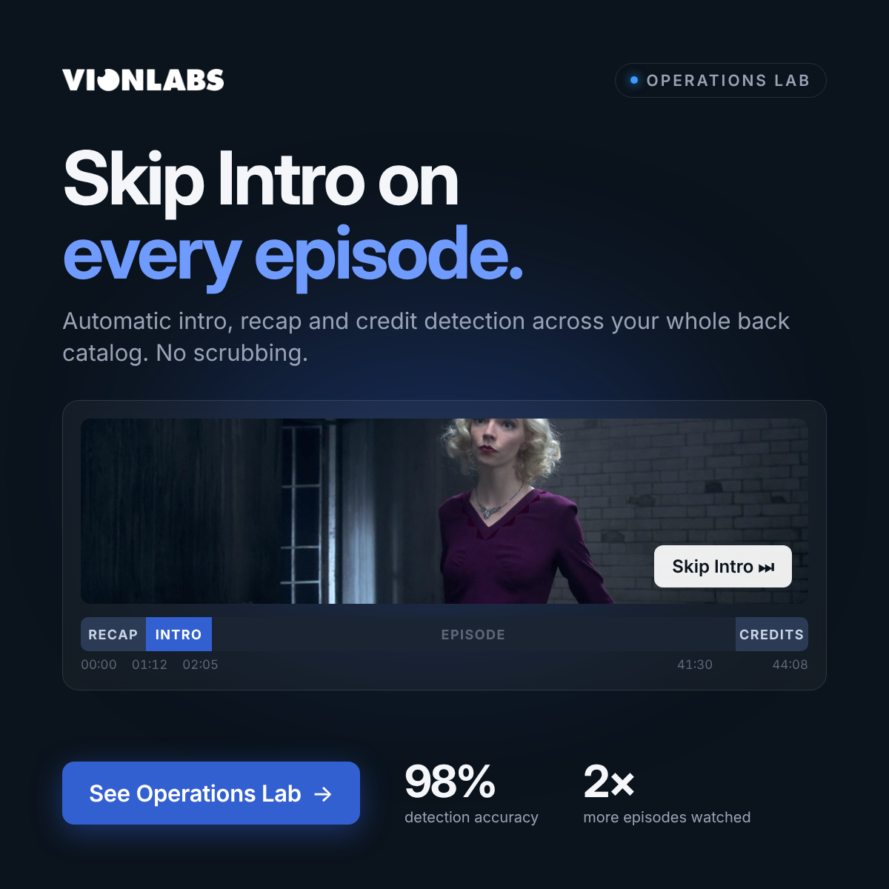

**Intro text**

> Viewers who can skip the intro watch more episodes.
>
> Operations Lab detects intros, recaps and credits with 98% accuracy, so Skip Intro and Next Episode work across your whole back catalog.

**Headline:** Skip Intro on every episode, automatically  
**CTA button:** Learn More  
**Audience:** Media operations, product and engagement leads at streamers  
**Inspired by:** Outcome headline plus proof stats, like TwelveLabs' “Review a 2-hour master in 12 minutes”

**Claims**

- 98% detection accuracy: vionlabs.com homepage and /operations-lab (Check before launch)
- 2× more episodes watched: vionlabs.com/operations-lab (AWS listing says session time) (Check before launch)

## op2 · Operations Lab · Ad breaks that respect the story

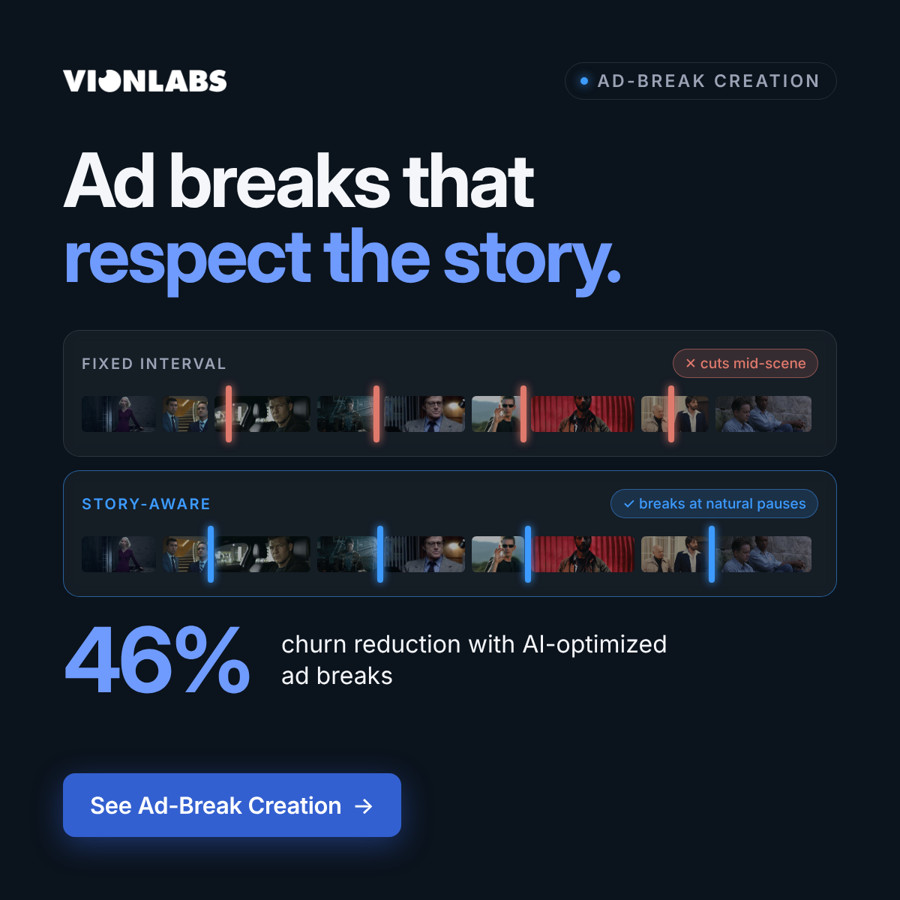

**Intro text**

> A fixed-interval ad break doesn’t care if it lands mid-sentence. Your viewers do.
>
> Story-aware ad breaks land at natural pauses. Compared with fixed-interval insertion, they cut churn by 46%.

**Headline:** 46% less churn with story-aware ad breaks  
**CTA button:** Learn More  
**Audience:** AVOD/FAST monetisation, ad operations and revenue leads  
**Inspired by:** Before → after comparison, like TwelveLabs' “Review a 2-hour master in 12 minutes”

**Claims**

- 46% churn reduction vs fixed-interval insertion: vionlabs.com/operations-lab; SDVI webinar post (Check before launch)

## op3 · Operations Lab · Ad breaks in minutes

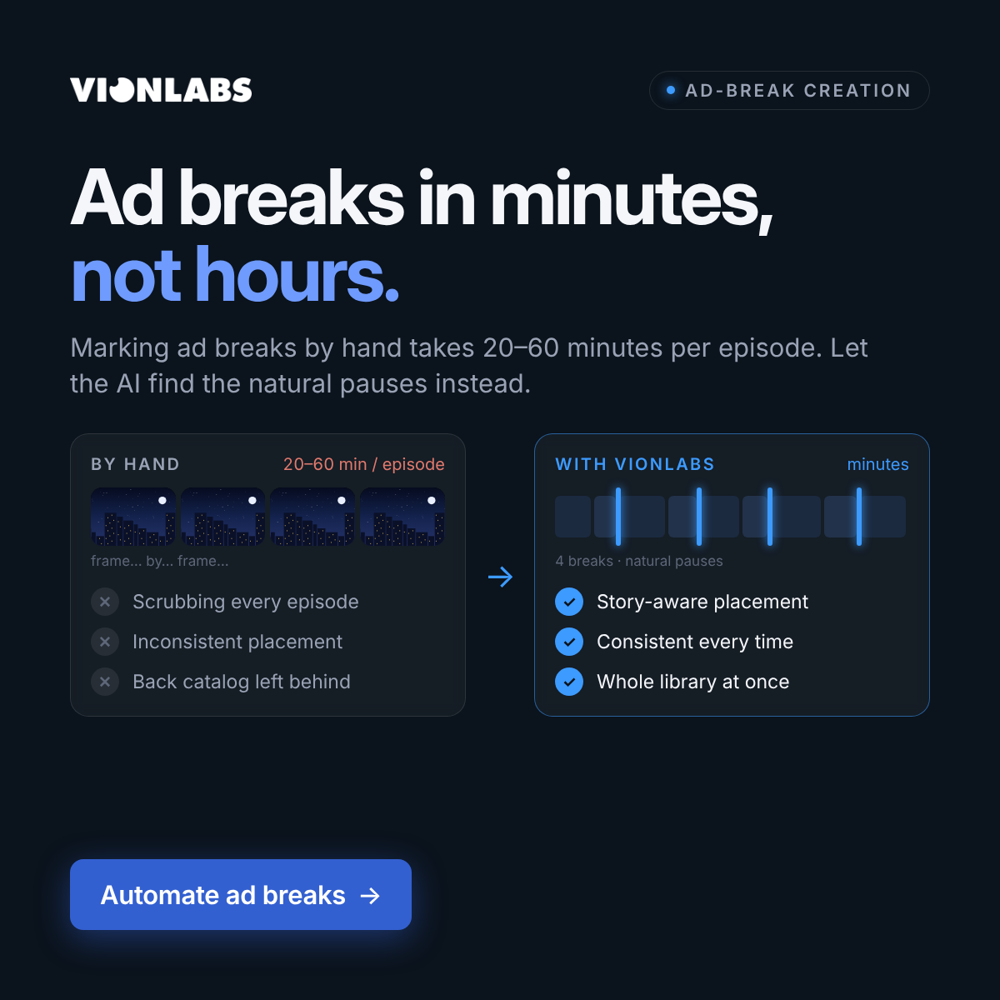

**Intro text**

> Marking ad breaks by hand takes 20 to 60 minutes per episode.
>
> Vionlabs Ad-Break Creation finds the natural pauses for you in minutes, so your back catalog can carry ads too.

**Headline:** Ad breaks in minutes, not hours  
**CTA button:** Request Demo  
**Audience:** Ad operations and media supply chain teams at AVOD/FAST services  
**Inspired by:** Time-saved headline with ✕ / ✓ lists, like TwelveLabs' “Review a 2-hour master in 12 minutes”

**Claims**

- Manual marking takes 20–60 min per episode; with AI, minutes: Vionlabs × SDVI webinar post (Check before launch)

## op4 · Operations Lab · Match the ad to the moment

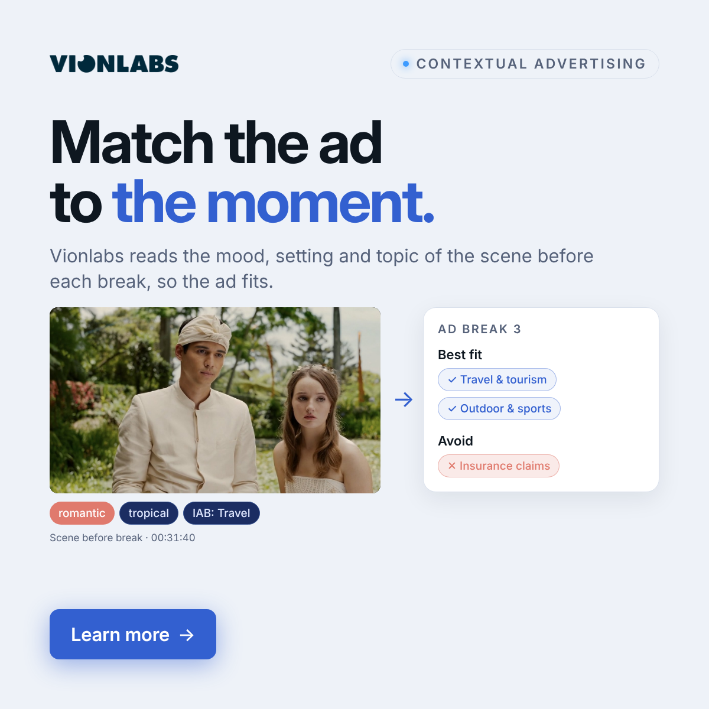

**Intro text**

> The scene before the break sets the mood for the ad.
>
> Vionlabs Contextual Advertising reads the mood, setting and topic of each scene, so the ad that follows fits the moment.

**Headline:** Match the ad to the moment  
**CTA button:** Learn More  
**Audience:** Ad sales, programmatic and monetisation leads at broadcasters and AVOD/FAST services  
**Inspired by:** Annotated scene → result, like TwelveLabs' “Focus on the story”

**Claims**

- Contextual ads: vionlabs.com/operations-lab (SEO description) (On the website)
- IAB topic mapping: vionlabs.com homepage (Compliance & Topic Detection) (Check before launch)
- Ad categories in the visual: UI mock (Example values)

## cs1 · Content Safety API · Check every scene before it airs

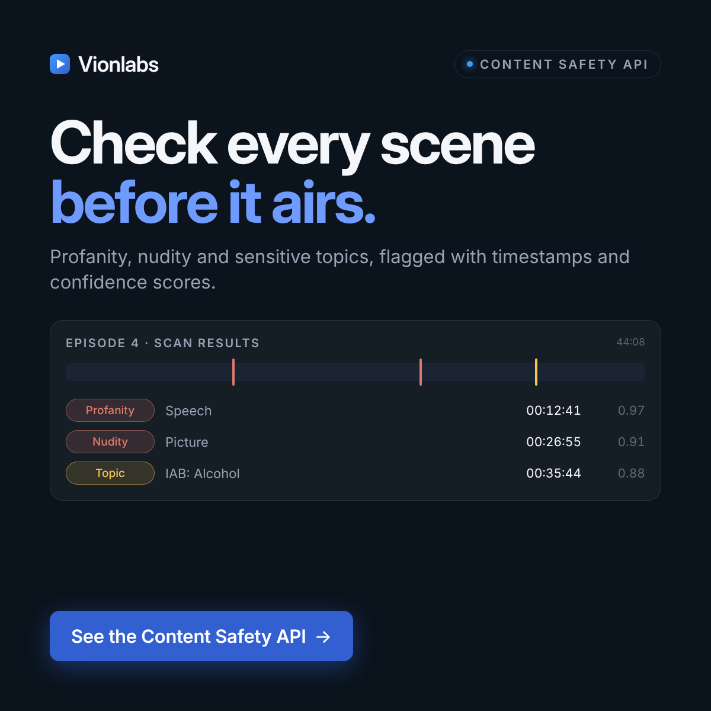

**Intro text**

> Compliance review shouldn’t mean watching every minute.
>
> The Vionlabs Content Safety API flags profanity in speech and nudity on screen with timestamps and confidence scores, and maps topics to IAB categories.

**Headline:** Check every scene before it airs  
**CTA button:** Learn More  
**Audience:** Compliance, standards & practices and ad operations teams  
**Inspired by:** Compliance angle, like TwelveLabs' “Trust but verify” webinar and “Can you trust every video?”

**Claims**

- Profanity (speech) and nudity (picture) flags with timestamps and confidence scores: vionlabs.com/api (Check before launch)
- Timestamps and scores in the visual: UI mock (Example values)

## vt1 · Verticalisation · A season of shorts

**Intro text**

> Your long-form library is full of short-form stories.
>
> Vionlabs Verticalisation splits films and episodes into chapters and micro-episodes, ready for vertical feeds.

**Headline:** Turn one film into a season of shorts  
**CTA button:** Learn More  
**Audience:** Social, digital and FAST channel teams at broadcasters and studios  
**Inspired by:** Fan-out diagram, like TwelveLabs' “One master. Five markets.”

**Claims**

- Long-form into chapters and micro-episodes: Streaming Media Q&A, ~Jun 2026 (Check before launch)

## api1 · Fingerprint+ API · Your video, as data

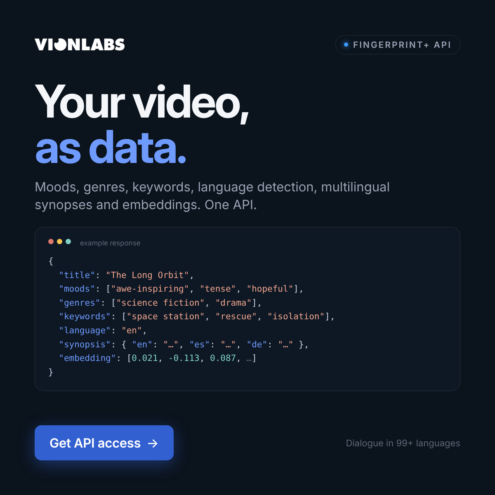

**Intro text**

> Moods, genres, keywords, language, synopses and embeddings from one API.
>
> The Vionlabs Fingerprint+ API turns every title into structured data your product and data teams can build on, with dialogue transcribed in 99+ languages.

**Headline:** Your video, as data: the Fingerprint+ API  
**CTA button:** Learn More  
**Audience:** CTOs, product and data engineering leads at media companies  
**Inspired by:** Product-as-hero, developer angle

**Claims**

- Moods, genres, keywords, language detection, multilingual synopses, embeddings: vionlabs.com/api (On the website)
- Dialogue transcribed in 99+ languages: vionlabs.com/our-ai (Check before launch)
- JSON response shape: Illustrative; replace with a real response from the API docs (Example values)

## emb1 · Embeddings API · Titles that feel alike

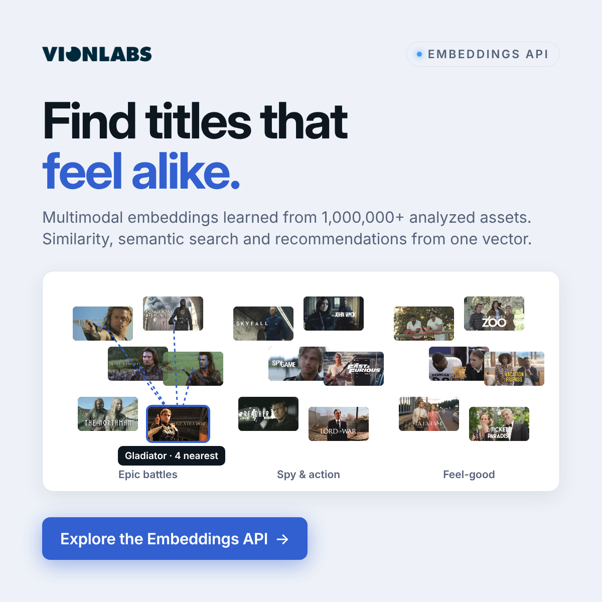

**Intro text**

> Search your catalog by how a title feels as well as by its tags.
>
> Vionlabs multimodal embeddings, learned from more than 1,000,000 analyzed assets, power similarity, semantic search and recommendations through one API.

**Headline:** Embeddings built for film and TV  
**CTA button:** Learn More  
**Audience:** Data science, ML and search/recommendation engineers at media companies  
**Inspired by:** Diagram-led, developer angle

**Claims**

- Multimodal embeddings for similarity, semantic search, recommendations: vionlabs.com/embeddings-api (SEO description) (On the website)
- 1,000,000+ analyzed assets: Curio launch press release (Check before launch)

## tr1 · Trust & deployment · Never leaves your environment

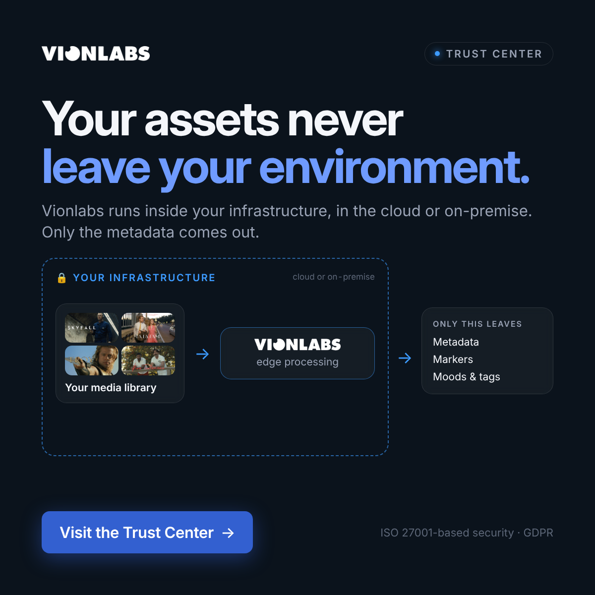

**Intro text**

> Your content is your most valuable asset. It can stay where it is.
>
> Vionlabs runs inside your infrastructure, in the cloud or on-premise, so no assets leave your environment. Security is ISO 27001-aligned and GDPR compliant.

**Headline:** AI that runs inside your infrastructure  
**CTA button:** Learn More  
**Audience:** CTOs, CISOs and media supply chain leads at studios and broadcasters  
**Inspired by:** Objection-handling diagram

**Claims**

- Runs within your infrastructure; no assets leave your environment: vionlabs.com homepage (Check before launch)
- Edge processing, ISO 27001-aligned, GDPR: vionlabs.com/trust-center (SEO description) (On the website)

## sp1 · Company · Signed to live in 30 days

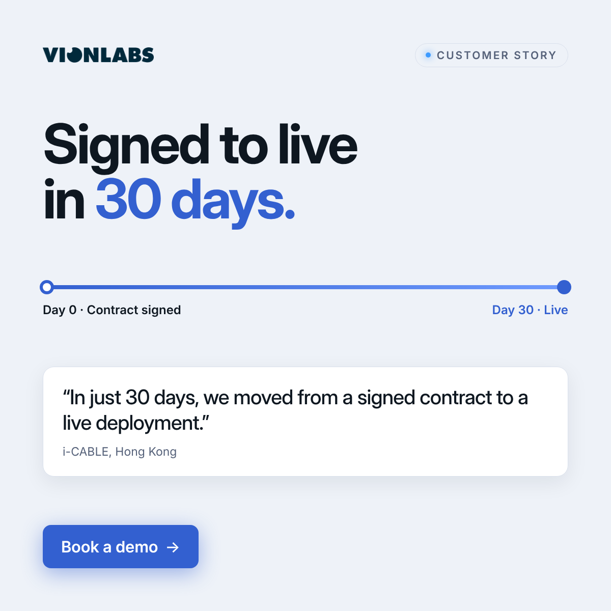

**Intro text**

> “In just 30 days, we moved from a signed contract to a live deployment.” i-CABLE, Hong Kong
>
> See how fast Vionlabs can be live on your catalog.

**Headline:** From signed contract to live in 30 days  
**CTA button:** Request Demo  
**Audience:** Procurement-stage buyers; retarget website and demo-page visitors  
**Inspired by:** Vionlabs original: customer quote and timeline

**Claims**

- i-CABLE quote: Vionlabs × SeaOvers press release, 11 Sep 2025 (Check before launch)

## br1 · Brand · Ours can feel it

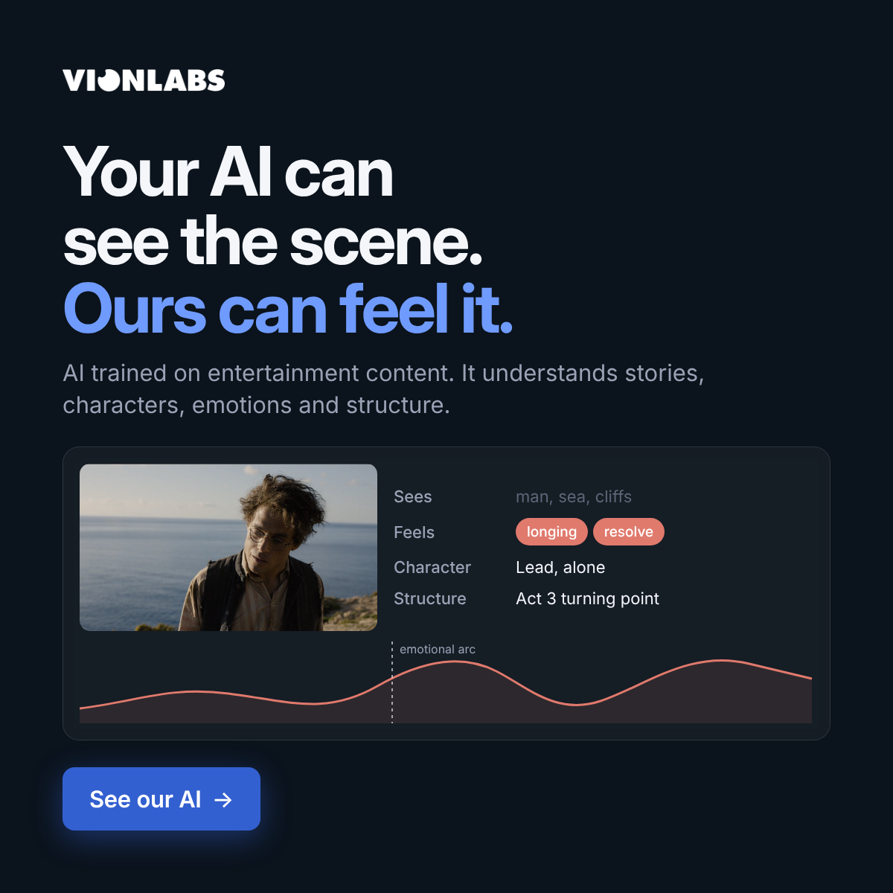

**Intro text**

> General-purpose AI can tell you there’s a person by a window. It can’t tell you the scene is about loss.
>
> Vionlabs models are trained on entertainment content and understand stories, characters, emotions and structure.

**Headline:** AI that understands stories  
**CTA button:** Learn More  
**Audience:** Broad media and entertainment audience; good for cold reach  
**Inspired by:** Positioning against general-purpose video AI

**Claims**

- Trained on entertainment content; understands stories, characters, emotions and structure: vionlabs.com/our-ai (SEO description) (On the website)
- Headline riffs on the blog post “Your AI Can See the Scene. It Can’t Feel It.”: Vionlabs blog (On the website)

## br2 · Brand · 20+ media companies

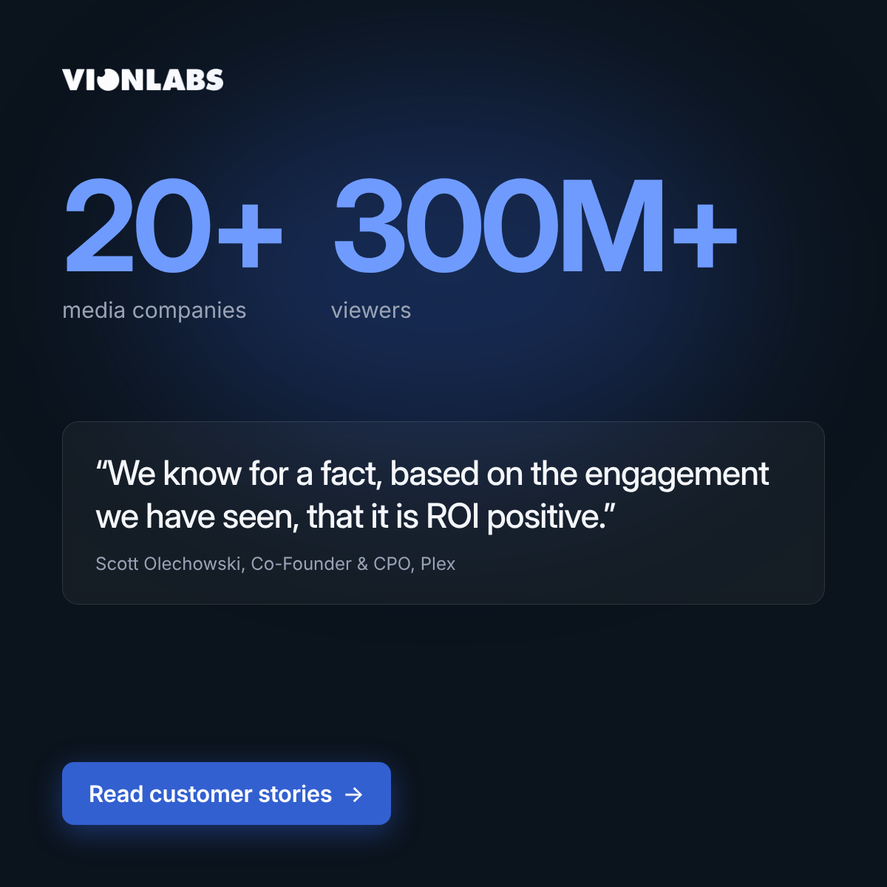

**Intro text**

> “Vionlabs enabled us to do the things we always wanted to do, but couldn’t do at scale.” Scott Olechowski, CPO, Plex
>
> More than 20 media companies use Vionlabs, reaching 300M+ viewers.

**Headline:** Trusted by 20+ media companies  
**CTA button:** Learn More  
**Audience:** Broad media and entertainment decision-makers; retargeting  
**Inspired by:** Vionlabs original: proof numbers and a customer quote

**Claims**

- 20+ media companies, 300M+ viewers: vionlabs.com homepage (“300M+ Happy Viewers”) (Check before launch)
- Plex quote: vionlabs.com/customer-stories (Check before launch)

## wb1 · Agentic Layer · Live webinar template

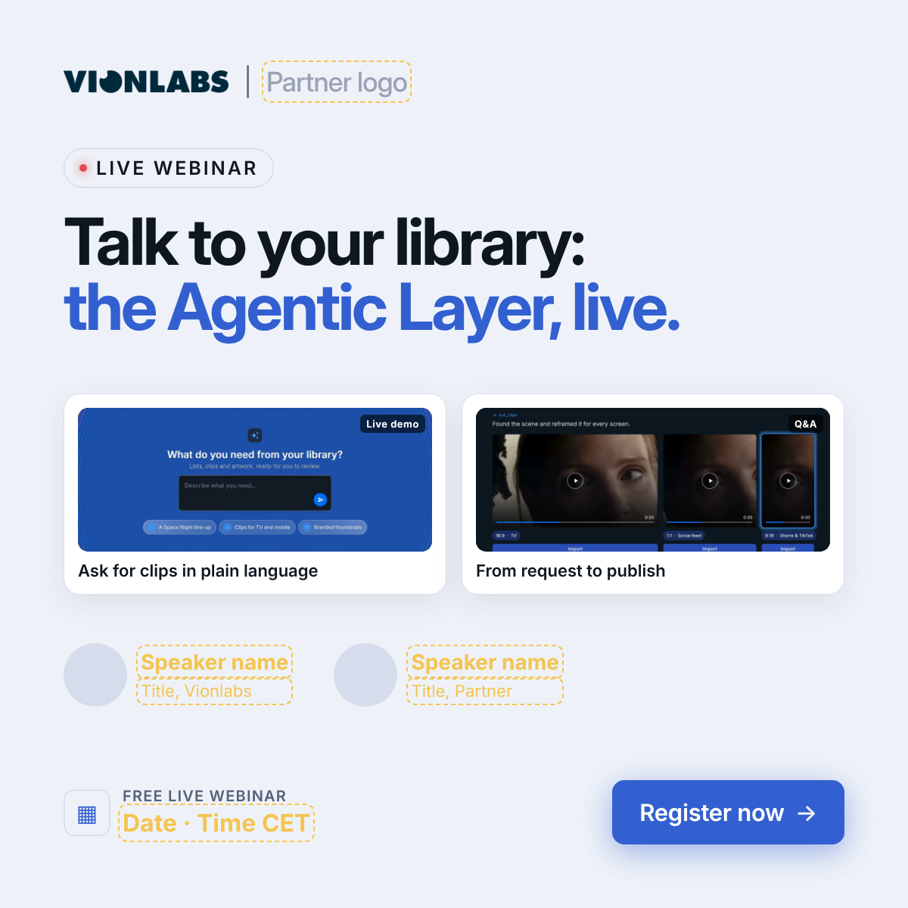

**Intro text**

> Watch the Agentic Layer work live. Ask for clips, lists and artwork in plain language, then approve and publish.
>
> [Date] · [Time CET] · Live demo and Q&A with [Speaker] and [Partner speaker].

**Headline:** Live webinar: talk to your video library  
**CTA button:** Register  
**Audience:** Everyone above; strongest as a retargeting and nurture ad  
**Inspired by:** Co-branded webinar with speakers and date, like TwelveLabs × NVIDIA “Trust But Verify”

**Claims**

- Date, time, speakers and partner logo: Placeholders (yellow dashed in the image) (Example values)
