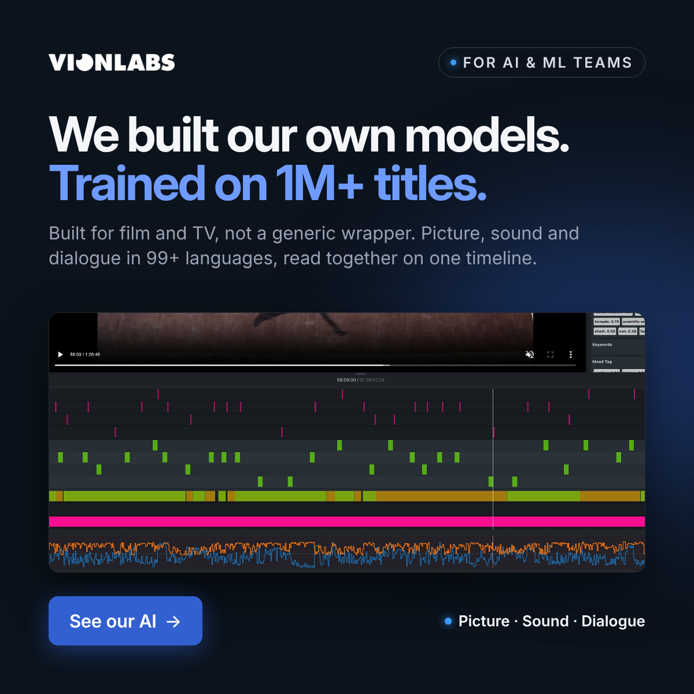
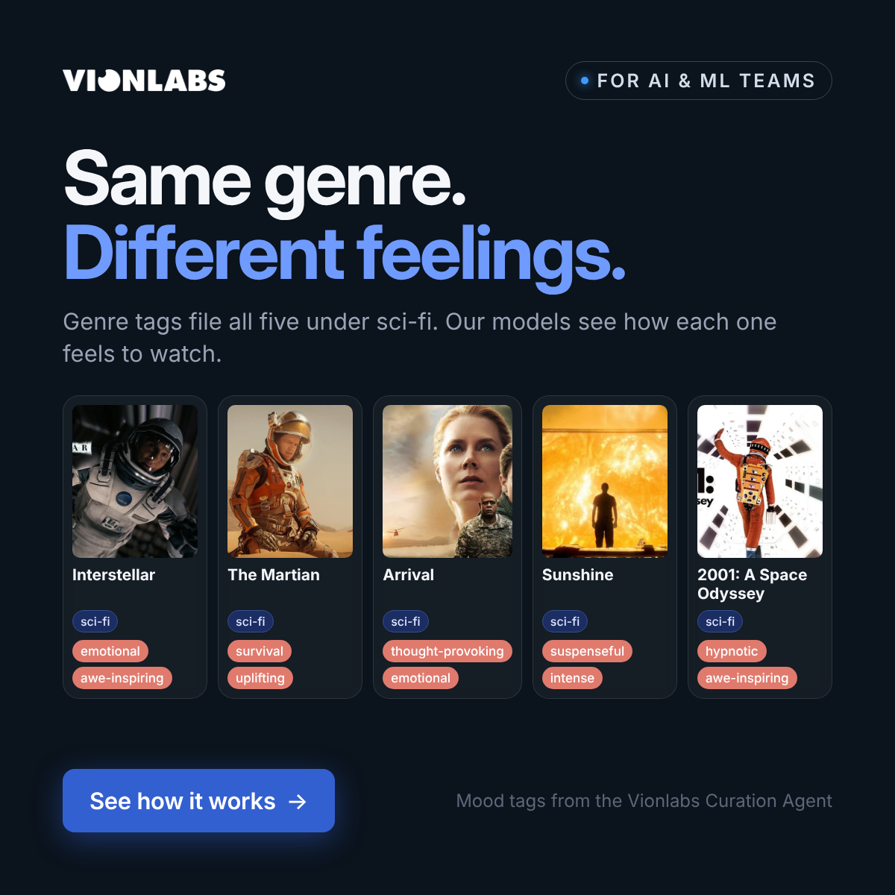
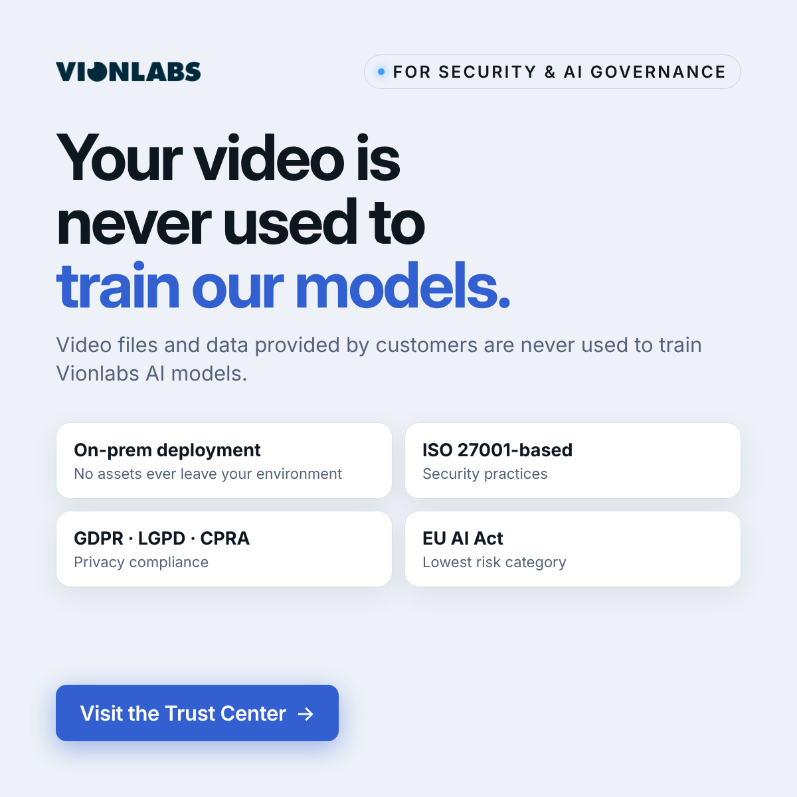
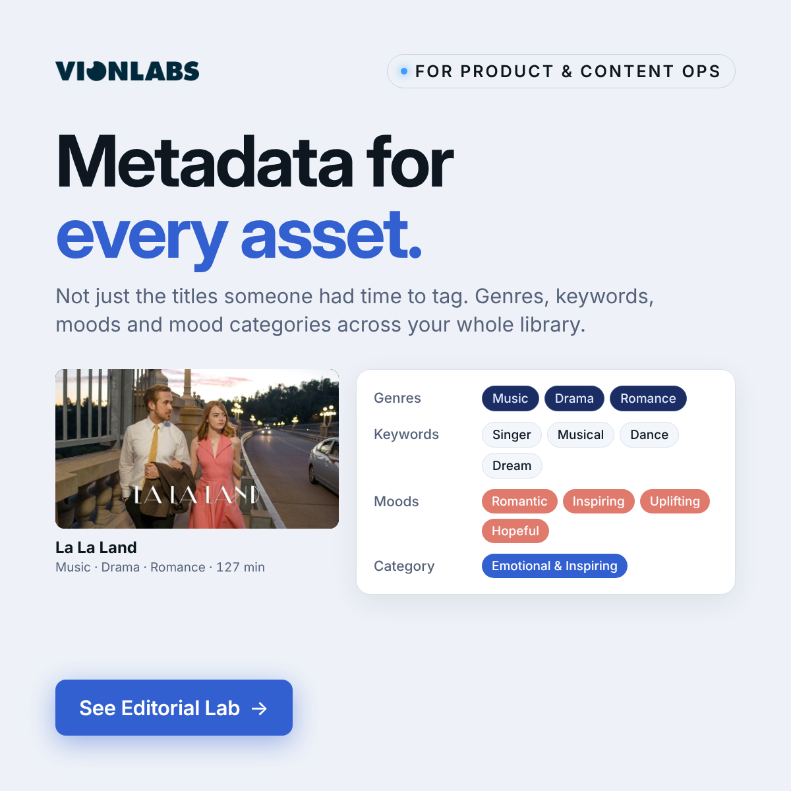
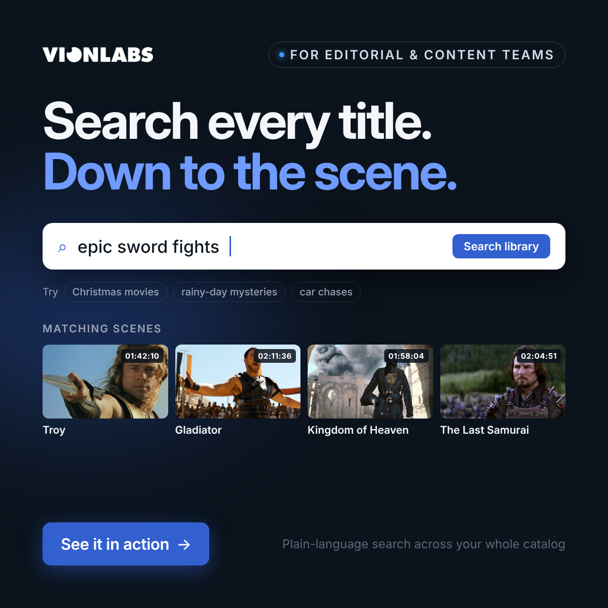
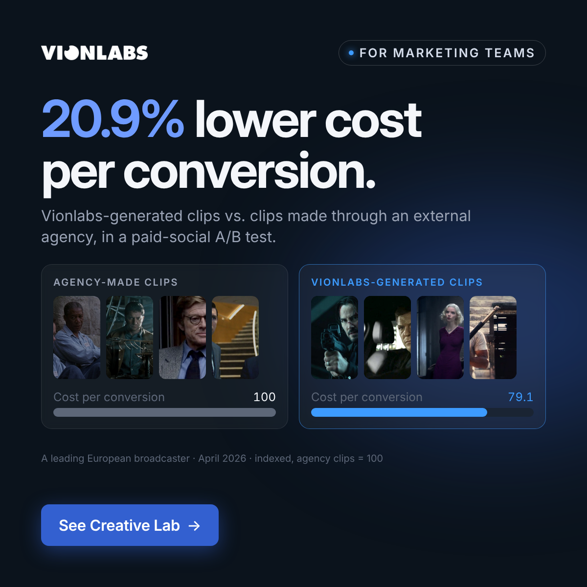
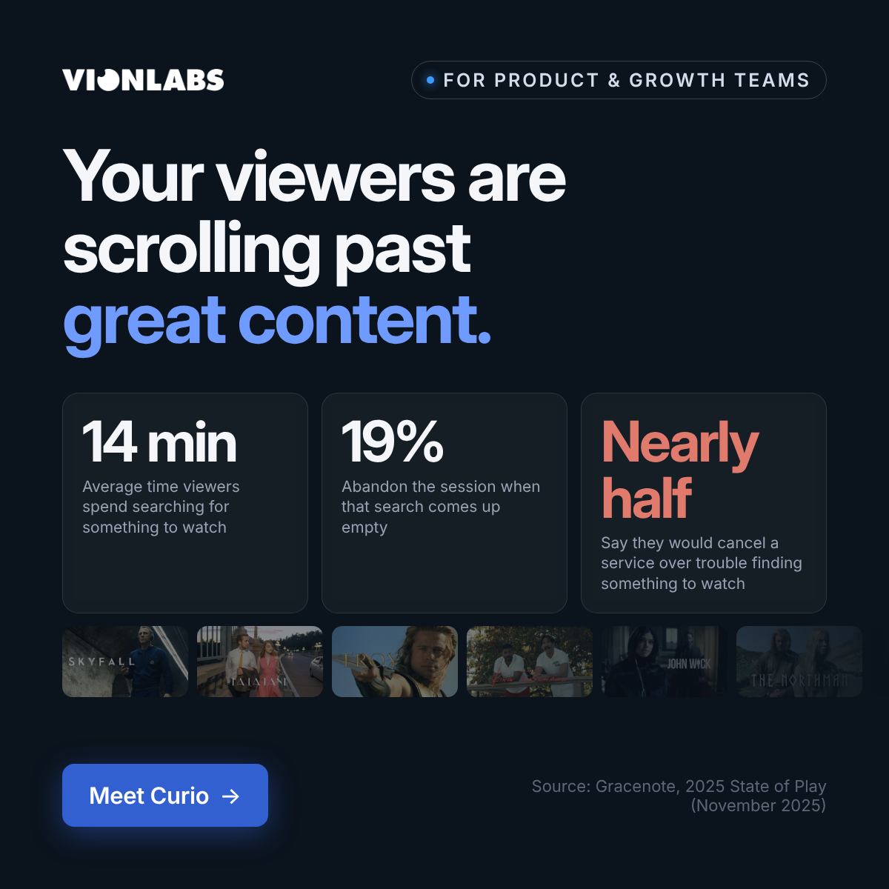
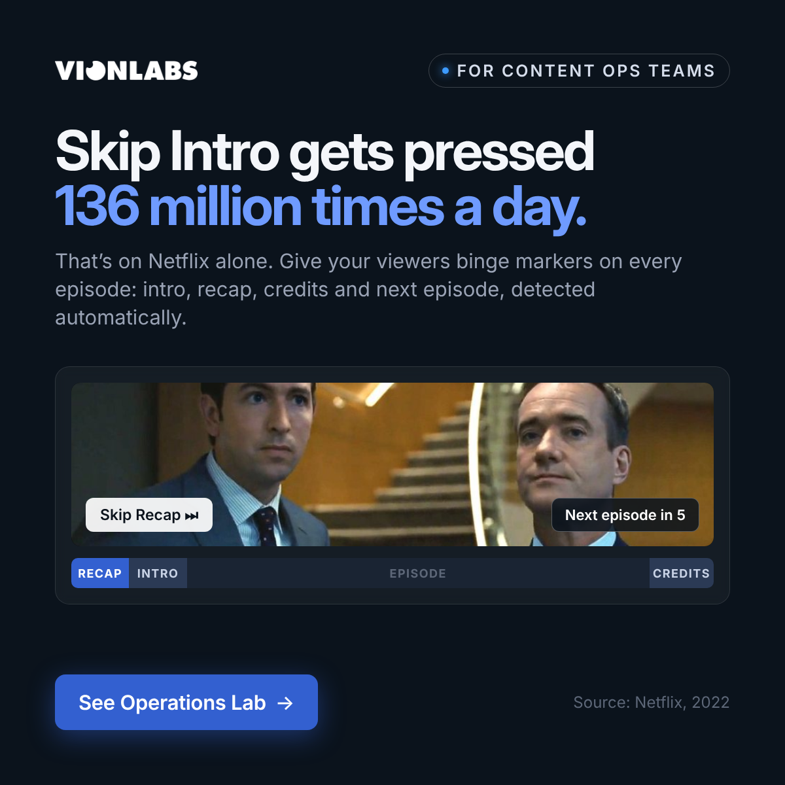
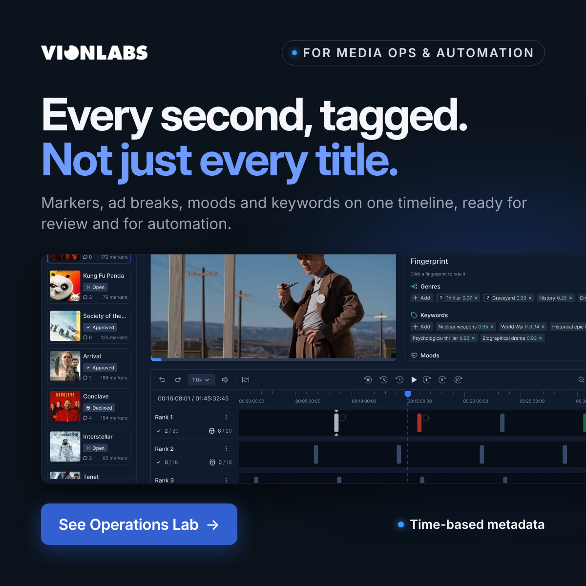
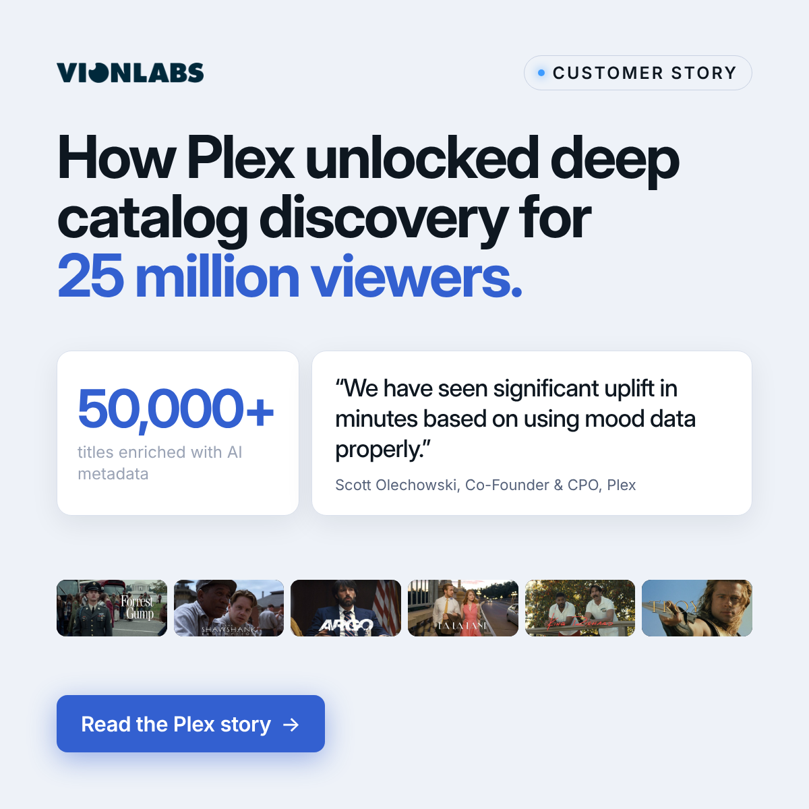

# Vionlabs LinkedIn ad copy

Single-image ads, 1200×1200. Images in `png/`, sources in `ads.html`.

## ai1 · Our AI · We built our own models

**Intro text**

> AI teams: general-purpose video models see objects. Film and TV need models that understand story.
>
> Vionlabs builds its own models, trained on more than 1M titles. They read picture, sound and dialogue in 99+ languages on one timeline, and understand mood, emotion and story structure.

**Headline:** Our own models, trained on 1M+ titles  
**CTA button:** Learn More  
**Audience:** ai  
**Inspired by:** Big claim plus real product timeline, like TwelveLabs’ “Generation is automated” pipeline

**Claims**

- Trained on 1M+ titles: Sales: “trained on 1M videos”; site: “learned from 1,000,000+ analyzed assets”; 2024 deck: “1 million unique titles analyzed” (Check before launch)
- Picture, soundtrack and dialogue in 99+ languages on a single timeline; “Domain-specific AI built for entertainment. Not a generic wrapper.”: vionlabs.com homepage (On the website)
- Video Lab timeline screenshot: Product image from vionlabs.com (On the website)

## ai2 · Our AI · Same genre, different feelings

**Intro text**

> ML and personalization teams: genre is a blunt signal. These five films are all sci-fi, and they feel nothing alike.
>
> Vionlabs models tag how each title feels to watch, from awe-inspiring to suspenseful, so recommendations and search can tell them apart.

**Headline:** Same genre. Different feelings.  
**CTA button:** Learn More  
**Audience:** ai  
**Inspired by:** Side-by-side comparison, like TwelveLabs’ “Focus on the story” before/after

**Claims**

- Genres and mood tags for the five films: Curation Agent screenshot on vionlabs.com/agentic-layer (On the website)
- Film backdrops: Images from vionlabs.com (Curio page) (On the website)

## br1 · Brand · Ours can feel it

**Intro text**

> AI teams: general-purpose AI can tell you there’s a man by the sea. It can’t tell you the scene is about longing.
>
> Vionlabs is domain-specific AI built for entertainment, not a generic wrapper. It understands stories, characters, emotions and structure.

**Headline:** AI that understands stories  
**CTA button:** Learn More  
**Audience:** ai  
**Inspired by:** Positioning against general-purpose video AI

**Claims**

- Trained on entertainment content; understands stories, characters, emotions and structure: vionlabs.com/our-ai (SEO description) (On the website)
- Headline riffs on the blog post “Your AI Can See the Scene. It Can’t Feel It.”: Vionlabs blog (On the website)
- “Domain-specific AI built for entertainment. Not a generic wrapper.”: vionlabs.com homepage (On the website)
- Sees / Feels / Structure labels on the Papillon frame: Illustration, not real model output (Example values)

## emb1 · Embeddings API · Titles that feel alike

**Intro text**

> ML and search teams: build on an embedding space trained for film and TV.
>
> Vionlabs multimodal embeddings, learned from more than 1,000,000 analyzed assets, power similarity, semantic search and recommendations, even without user history.

**Headline:** Embeddings built for film and TV  
**CTA button:** Learn More  
**Audience:** ai  
**Inspired by:** Diagram-led, developer angle

**Claims**

- Similarity, semantic search, recommendations; “Embeddings enable recommendation systems even without user history.”: vionlabs.com/embeddings-api (On the website)
- 1,000,000+ analyzed assets: vionlabs.com/curio (On the website)
- Title clusters and Gladiator’s nearest neighbours: Illustration using title art from vionlabs.com, not real embedding output (Example values)

## api1 · Fingerprint+ API · Your video, as data

**Intro text**

> Engineering teams: get moods, genres, keywords, language, synopses and embeddings for every title from one API.
>
> Clean RESTful APIs and structured JSON, with 99+ languages built in. Available on Google Cloud Marketplace and AWS Marketplace.

**Headline:** Your video, as data: the Fingerprint+ API  
**CTA button:** Learn More  
**Audience:** ai  
**Inspired by:** Product-as-hero, developer angle

**Claims**

- Fingerprint+: moods, genres, keywords, language detection, multilingual synopses, embeddings: vionlabs.com/api (On the website)
- “Clean RESTful APIs. Structured JSON responses.”; Google Cloud and AWS Marketplace; 99+ languages: vionlabs.com/api and homepage (On the website)
- Metadata (genre, keyword, mood scores and similar titles) screenshot: Product image from vionlabs.com (On the website)

## cu1 · Curio · How titles feel

**Intro text**

> Personalization teams: two titles can share a genre and feel nothing alike.
>
> Curio matches viewers on pacing, tone and emotional arc, not just the genre a title is filed under. It powers Because You Watched, personalized rows and similar titles.

**Headline:** Recommendations matched on how titles feel  
**CTA button:** Learn More  
**Audience:** ai  
**Inspired by:** Annotated side-by-side, like TwelveLabs' “Focus on the story”

**Claims**

- Matches viewers to how titles feel to watch; Because You Watched, personalized rows, similar titles: vionlabs.com/curio (SEO description) (On the website)
- “Matched on pacing, tone and emotional arc, not just the genre a title is filed under.”: vionlabs.com/curio (On the website)
- Curio Similar titles screenshot: Product image from vionlabs.com (On the website)

## tr1 · Trust & deployment · Never leaves your environment

**Intro text**

> Security and IT teams: your content is your most valuable asset. It can stay where it is.
>
> Vionlabs deploys on-prem within your infrastructure, so no assets ever leave your environment. Security follows ISO 27001-based practices.

**Headline:** AI that runs inside your infrastructure  
**CTA button:** Learn More  
**Audience:** ai  
**Inspired by:** Objection-handling diagram

**Claims**

- “We deploy on-prem within your infrastructure – no assets ever leave your environment.”: vionlabs.com homepage (On the website)
- “ISO 27001-based security practices” (not a certification), GDPR: vionlabs.com/trust-center (On the website)

## tr2 · Trust & deployment · Never used to train our models

**Intro text**

> Security and AI governance teams ask one question before anything else.
>
> Video files and data provided by customers are never used to train Vionlabs AI models. Deploy on-prem and no assets ever leave your environment.

**Headline:** Your video never trains our models  
**CTA button:** Learn More  
**Audience:** ai  
**Inspired by:** Objection-handling statement with proof tiles

**Claims**

- “Video files and data provided by customers are never used to train Vionlabs AI models.”: vionlabs.com/trust-center (On the website)
- ISO 27001-based security practices; GDPR, LGPD, CPRA; EU AI Act lowest risk category (Risk Level 4): vionlabs.com/trust-center (On the website)
- On-prem, no assets leave your environment: vionlabs.com homepage (On the website)

## md1 · Metadata enrichment · Metadata for every asset

**Intro text**

> Content ops and product teams: most catalogs only have rich metadata for the titles someone had time to tag.
>
> Vionlabs enriches every asset with genres, keywords, moods and mood categories, so search, rows and recommendations work across the whole library.

**Headline:** Metadata for every asset in your library  
**CTA button:** Learn More  
**Audience:** product  
**Inspired by:** Product output as the hero, like TwelveLabs’ product-UI visuals

**Claims**

- La La Land genres, keywords, moods and mood category: Vionlabs company presentation (IBC 2024), metadata enrichment slide (Check before launch)
- “Emotion, mood, genre & theme tagging at scale”: vionlabs.com/editorial-lab (On the website)

## sr1 · Library search · Search down to the scene

**Intro text**

> Editorial and content teams: find every Christmas movie in your library. Or every sword fight. Or every rainy-day mystery.
>
> Search your whole catalog in plain language and get back the titles and the exact scenes.

**Headline:** Search your whole library, down to the scene  
**CTA button:** Request Demo  
**Audience:** product  
**Inspired by:** Product UI as the hero

**Claims**

- Search by mood, moment or character; natural-language queries: vionlabs.com/ibc-2026 and /creative-lab (On the website)
- Query, results and timestamps in the visual: Example search using frames from vionlabs.com, not real search output (Example values)

## ed1 · Editorial Lab · 90%+ of your catalog

**Intro text**

> Editorial teams: you can’t hand-curate a whole catalog. You don’t have to.
>
> Editorial Lab suggests mood-, genre- and plot-based Smartlists with 90%+ catalog coverage. Turn 3,000 assets into 80 curated lists automatically, then pick what goes live.

**Headline:** Mood-based lists for 90%+ of your catalog  
**CTA button:** Learn More  
**Audience:** product  
**Inspired by:** Stat headline over product UI

**Claims**

- “AI-curated Smartlists with 90%+ catalog coverage”; “Transform 3,000 assets into 80 curated lists automatically”: vionlabs.com/editorial-lab (On the website)
- List names, moods and titles in the visual: Example lists using title art from vionlabs.com (Example values)

## ed2 · Editorial Lab · Hidden content is hidden revenue

**Intro text**

> Programming teams: the titles nobody finds are titles you paid for and never earn from.
>
> Editorial Lab surfaces your deep catalog in fresh mood- and plot-driven rows, so more of your library gets watched.

**Headline:** Hidden content is hidden revenue  
**CTA button:** Learn More  
**Audience:** product  
**Inspired by:** Before → after with ✕ / ✓ lists, like TwelveLabs' “Review a 2-hour master in 12 minutes”

**Claims**

- “Hidden content is hidden revenue”: Vionlabs blog headline (On the website)
- 90%+ catalog coverage: vionlabs.com/editorial-lab (On the website)

## ag1 · Agentic Layer · Talk to your video library

**Intro text**

> Content teams: your video library has the answers. Now you can just ask.
>
> The Vionlabs Agentic Layer curates lists, cuts clips in every ratio and creates branded thumbnails from a plain-language request. Nothing goes live until your team approves it.

**Headline:** Talk to your video library  
**CTA button:** Request Demo  
**Audience:** product  
**Inspired by:** Product UI as the hero, like TwelveLabs' “Focus on the story” before/after visual

**Claims**

- Curates lists, cuts clips in every ratio, creates branded thumbnails: vionlabs.com/agentic-layer (SEO description) (On the website)
- “Nothing goes live until your team approves it”: vionlabs.com/agentic-layer (On the website)
- Curation Agent screenshot: Product image from vionlabs.com (On the website)
- “Best of Show · IBC2026” line in the image: TVBEurope Best of Show awards, 14 Sep 2026 (Check before launch)

## ag2 · Agentic Layer · Ask. Approve. Publish.

**Intro text**

> Content ops teams: a teaser or a thumbnail shouldn’t mean a queue of requests.
>
> Ask the Agentic Layer in plain language. It does the work, and your team reviews and publishes.

**Headline:** Ask. Approve. Publish.  
**CTA button:** Request Demo  
**Audience:** product  
**Inspired by:** Pipeline diagram with an approval step, like TwelveLabs' “Review shouldn’t be the bottleneck”

**Claims**

- “Ask. Approve. Publish.”: vionlabs.com/agentic-layer (Open Graph title) (On the website)
- Creative Agent branded-thumbnails screenshot: Product image from vionlabs.com (On the website)
- “Best of Show · IBC2026” line in the image: TVBEurope Best of Show awards, 14 Sep 2026 (Check before launch)

## ag3 · Agentic Layer · One title. Every ratio.

**Intro text**

> Social and promo teams: every channel wants a different shape.
>
> Ask the Agentic Layer for a clip. It finds the scene and reframes it for TV, feeds and Shorts, in 16:9, 1:1 and 9:16.

**Headline:** Every ratio from one request  
**CTA button:** Learn More  
**Audience:** product  
**Inspired by:** Three-beat headline and fan-out diagram, like TwelveLabs' “One master. Five markets.”

**Claims**

- “Found the scene and reframed it for every screen.”; “The right scene, cut for TV, feeds and Shorts.”: vionlabs.com/agentic-layer (On the website)
- Creative Agent clips screenshot: Product image from vionlabs.com (On the website)
- “Best of Show · IBC2026” line in the image: TVBEurope Best of Show awards, 14 Sep 2026 (Check before launch)

## cr1 · Creative Lab · The visual it deserves

**Intro text**

> Creative teams: a random frame makes a bad first impression.
>
> Creative Lab turns your brand rules into recipes, then picks the strongest scene and places the title, for every title in your catalog.

**Headline:** On-brand thumbnails for every title  
**CTA button:** Learn More  
**Audience:** product  
**Inspired by:** Annotated before/after imagery, like TwelveLabs' “Focus on the story. Not the edit.”

**Claims**

- “Every asset gets the visual it deserves”; thumbnails and preview clips at scale: vionlabs.com/creative-lab (SEO description) (On the website)
- Recipes (mood, keywords, characters, key moments): Creative Lab press release, 9 Sep 2025 (On the website)
- Skyfall raw frame vs. finished thumbnail: Creative Lab examples on vionlabs.com (On the website)

## cr2 · Creative Lab · Write the recipe once

**Intro text**

> Creative teams: set the mood, the moment and the format once.
>
> Creative Lab applies your recipe across the catalog and generates high-quality thumbnails, previews and shorts from 16:9 to 9:16, so every asset comes to life.

**Headline:** One recipe. Art for every title.  
**CTA button:** Request Demo  
**Audience:** product  
**Inspired by:** Input → output diagram, like TwelveLabs' “Generation is automated” pipeline

**Claims**

- Recipes; formats 16:9 to 9:16: Creative Lab press release, 9 Sep 2025 (On the website)
- Recipe fields in the visual: Example recipe; thumbnails are Creative Lab examples from vionlabs.com (Example values)

## cr3 · Creative Lab · 20.9% lower cost per conversion

**Intro text**

> Marketing teams: whose clips convert better, your agency’s or the AI’s?
>
> At a leading European broadcaster, a paid-social A/B test in April 2026 measured a 20.9% lower cost per conversion with Vionlabs-generated clips than with clips made through an external agency.

**Headline:** 20.9% lower cost per conversion with AI clips  
**CTA button:** Learn More  
**Audience:** product  
**Inspired by:** Big measured result with a side-by-side, like TwelveLabs' “Review a 2-hour master in 12 minutes”

**Claims**

- 20.9% lower cost per conversion vs agency-made clips (paid-social A/B test, April 2026, unnamed European broadcaster): vionlabs.com/agentic-layer, Results section (no footnote) (On the website)
- Bars indexed to agency clips = 100 (79.1 is 20.9% lower): Derived from the 20.9% figure (Example values)
- Clip frames in the visual: Example frames from vionlabs.com, not the clips from the A/B test (Example values)

## vt1 · Verticalisation · A season of shorts

**Intro text**

> Social and digital teams: your long-form library is full of short-form stories.
>
> Vionlabs Verticalisation splits films and episodes into chapters and micro-episodes, ready for vertical feeds.

**Headline:** Turn one film into a season of shorts  
**CTA button:** Learn More  
**Audience:** product  
**Inspired by:** Fan-out diagram, like TwelveLabs' “One master. Five markets.”

**Claims**

- Long-form into chapters and micro-episodes: Streaming Media Q&A, ~Jun 2026 (Check before launch)
- Gladiator chapter strip and vertical episodes: Crops of two website frames to show the idea, not real Verticalisation output (Example values)

## cu2 · Curio · Recommend before the first view

**Intro text**

> Product teams: new titles have no viewing history. That’s exactly when they need recommending.
>
> Curio understands every title from day one, so new releases and long-tail content show up in the right rows from the start.

**Headline:** Recommend new titles from day one  
**CTA button:** Learn More  
**Audience:** product  
**Inspired by:** Problem-first hook, like TwelveLabs' “Detection tools were supposed to…” intro

**Claims**

- “New releases and long-tail titles get recommended from day one, before anyone has watched them.”: vionlabs.com/curio (On the website)
- “The Northman · added today · 0 views” and the rows around it: Example scenario using title art from vionlabs.com (Example values)

## cu3 · Curio · 1M+ analyzed assets

**Intro text**

> Product teams: Great American Pure Flix is the first platform to bring Curio to its members.
>
> Curio’s recommendations come from embeddings learned from more than 1,000,000 analyzed assets, powering Because You Watched, personalized rows and similar titles.

**Headline:** Curio: AI recommendations, now live  
**CTA button:** Learn More  
**Audience:** product  
**Inspired by:** Big-number hero, like TwelveLabs' “Review a 2-hour master in 12 minutes”

**Claims**

- “Pure Flix is now the first platform to bring Curio to its members”: vionlabs.com/curio (On the website)
- 1,000,000+ analyzed assets: vionlabs.com/curio and /agentic-layer (On the website)
- Curio Because You Watched screenshot: Product image from vionlabs.com (On the website)

## cu4 · Curio · Scrolling past great content

**Intro text**

> Product and growth teams: viewers spend 14 minutes on average searching for something to watch, and nearly half say they would cancel a service over trouble finding something to watch.
>
> Curio matches viewers to how a title feels to watch. Less searching. More watching.
>
> Source: Gracenote, 2025 State of Play (November 2025).

**Headline:** Less searching. More watching.  
**CTA button:** Learn More  
**Audience:** product  
**Inspired by:** Problem first, backed by third-party numbers, like TwelveLabs' “Detection tools were supposed to make video review easier” hook

**Claims**

- 14 min searching; 19% abandon the session; nearly half would cancel: Gracenote, 2025 State of Play (Nov 2025), survey of 3,000 consumers in 6 countries; quoted on vionlabs.com/curio (On the website)
- “Your Viewers Are Scrolling Past Great Content”; “Less searching. More watching.”: vionlabs.com homepage and /curio (On the website)

## bm1 · Operations Lab · 136 million Skip Intro presses

**Intro text**

> Content ops teams: on Netflix, Skip Intro is pressed 136 million times on a typical day.
>
> Give your viewers the same. Vionlabs detects intros, recaps and credits automatically and delivers binge markers for every episode in your catalog.
>
> Source: Netflix, 2022.

**Headline:** Binge markers for every episode, automatically  
**CTA button:** Learn More  
**Audience:** ops  
**Inspired by:** Big third-party number as the hook, like TwelveLabs’ “Review a 2-hour master in 12 minutes”

**Claims**

- Skip Intro pressed 136 million times on a typical day: Netflix, “Looking back on the origin of Skip Intro five years later” (2022) (On the website)
- Succession frame, buttons and timeline: Example frame from vionlabs.com; buttons and timeline are a mock-up (Example values)

## tm1 · Operations Lab · Time-based metadata

**Intro text**

> Media ops and automation teams: most metadata describes a title. Your workflows need to know what happens at minute 41.
>
> Vionlabs delivers time-based metadata: intro and credit markers, ad breaks, moods and keywords on one timeline, ready for review and automation.

**Headline:** Time-based metadata for every title  
**CTA button:** Learn More  
**Audience:** ops  
**Inspired by:** Real product screenshot as the hero

**Claims**

- Operations Lab batch review screenshot: Product image from vionlabs.com (On the website)
- “API-first architecture integrates easily with your CMS, MAM, and ad technology stack.”: vionlabs.com/operations-lab (On the website)

## op1 · Operations Lab · Skip Intro on every episode

**Intro text**

> Content ops teams: Skip Intro shouldn’t depend on someone scrubbing every episode.
>
> Operations Lab detects intros, recaps and credits with 98% accuracy, so Skip Intro and Next Episode work across your whole back catalog.

**Headline:** Skip Intro on every episode, automatically  
**CTA button:** Learn More  
**Audience:** ops  
**Inspired by:** Outcome headline plus proof stats, like TwelveLabs' “Review a 2-hour master in 12 minutes”

**Claims**

- “Detect intros, recaps, and credits at 98% accuracy”: vionlabs.com homepage; no source given on the page (Check before launch)
- “2× More Episodes Watched”: vionlabs.com/operations-lab; no source given (AWS listing says session time) (Check before launch)
- Peaky Blinders frame with Skip Intro button and timeline: Example frame from vionlabs.com; button and timeline are a mock-up (Example values)

## op2 · Operations Lab · Ad breaks that respect the story

**Intro text**

> Ad ops and monetization teams: a fixed-interval ad break doesn’t care if it lands mid-sentence. Your viewers do.
>
> “Bad ad breaks can destroy engagement, and we have proven that Vionlabs improves it.” Scott Olechowski, Co-Founder & CPO, Plex

**Headline:** Ad breaks that respect the story  
**CTA button:** Learn More  
**Audience:** ops  
**Inspired by:** Before → after comparison, like TwelveLabs' “Review a 2-hour master in 12 minutes”

**Claims**

- “46% churn reduction with AI-optimized ad breaks”: vionlabs.com homepage; no source given on the page (Check before launch)
- “Create ad breaks that respect the story.”: vionlabs.com/operations-lab (On the website)
- Plex quote: Plex customer story on vionlabs.com (On the website)

## op3 · Operations Lab · Ad breaks in minutes

**Intro text**

> Media ops teams: marking ad breaks by hand takes 20 to 60 minutes per episode.
>
> Vionlabs Ad-Break Creation finds the natural pauses for you in minutes, so your back catalog can carry ads too.

**Headline:** Ad breaks in minutes, not hours  
**CTA button:** Request Demo  
**Audience:** ops  
**Inspired by:** Time-saved headline with ✕ / ✓ lists, like TwelveLabs' “Review a 2-hour master in 12 minutes”

**Claims**

- Manual marking takes 20–60 min per episode; with AI, minutes: Vionlabs × SDVI webinar post (Check before launch)
- AI-powered ad-break screenshot: Product image from vionlabs.com (On the website)

## op4 · Operations Lab · Match the ad to the moment

**Intro text**

> Ad sales teams: the scene before the break sets the mood for the ad.
>
> Vionlabs Contextual Advertising reads the mood, setting and topic of each scene, so the ad that follows fits the moment.

**Headline:** Match the ad to the moment  
**CTA button:** Learn More  
**Audience:** ops  
**Inspired by:** Annotated scene → result, like TwelveLabs' “Focus on the story”

**Claims**

- “Serve ads that match the moment.”; “Contextual targeting (IAB, mood, keywords)”: vionlabs.com/operations-lab (On the website)
- Ad categories in the visual: UI mock (Example values)
- Ticket to Paradise frame and its tags: Example frame from vionlabs.com; tags are a mock-up (Example values)

## cs1 · Content Safety API · Check every scene before it airs

**Intro text**

> Compliance teams: review shouldn’t mean watching every minute.
>
> The Vionlabs Content Safety API flags profanity in speech and nudity on screen with timestamps and confidence scores, and maps topics to IAB categories.

**Headline:** Check every scene before it airs  
**CTA button:** Learn More  
**Audience:** ops  
**Inspired by:** Compliance angle, like TwelveLabs' “Trust but verify” webinar and “Can you trust every video?”

**Claims**

- Content Safety API (one of nine Content Intelligence APIs); profanity and nudity flags with timestamps and confidence scores: vionlabs.com/api (flag details from a search snippet) (Check before launch)
- Timestamps and scores in the visual: UI mock (Example values)

## ag4 · Agentic Layer · Best of Show at IBC2026

**Intro text**

> The Agentic Layer won Best of Show at IBC2026.
>
> It lets media teams talk to their video library. Search by mood, moment or character, then get clips, lists and artwork back, ready to approve.

**Headline:** IBC2026 Best of Show: the Agentic Layer  
**CTA button:** Request Demo  
**Audience:** all  
**Inspired by:** Vionlabs original: award as social proof

**Claims**

- TVBEurope Best of Show award at IBC2026: tvbeurope.com, 14 Sep 2026 (Check before launch)
- Medal artwork: Stand-in; swap for TVBEurope's official winner badge (Check before launch)
- Agentic Layer “What do you need from your library?” screenshot: Product image from vionlabs.com (On the website)

## pl1 · Company · Plex customer story

**Intro text**

> How did Plex unlock deep catalog discovery for 25 million viewers?
>
> Vionlabs enriched 50,000+ titles with AI metadata. “We have seen significant uplift in minutes based on using mood data properly.” Scott Olechowski, Co-Founder & CPO, Plex

**Headline:** How Plex unlocked deep catalog discovery  
**CTA button:** Learn More  
**Audience:** all  
**Inspired by:** Vionlabs original: customer story promo

**Claims**

- 25 million viewers: Plex story title on vionlabs.com (not repeated in the body) (Check before launch)
- 50,000+ titles enriched with AI metadata; quote: Plex customer story on vionlabs.com (On the website)

## sp1 · Company · Signed to live in 30 days

**Intro text**

> “In just 30 days, we moved from a signed contract to a live deployment.” i-CABLE, Hong Kong
>
> See how fast Vionlabs can be live on your catalog.

**Headline:** From signed contract to live in 30 days  
**CTA button:** Request Demo  
**Audience:** all  
**Inspired by:** Vionlabs original: customer quote and timeline

**Claims**

- i-CABLE quote: Vionlabs × SeaOvers press release, 11 Sep 2025 (Check before launch)

## br2 · Brand · 20+ media companies

**Intro text**

> “We know for a fact, based on the engagement we have seen, that it is ROI positive.” Scott Olechowski, Co-Founder & CPO, Plex
>
> 20+ media companies use Vionlabs to make their libraries discoverable, engaging and revenue-ready.

**Headline:** Trusted by 20+ media companies  
**CTA button:** Learn More  
**Audience:** all  
**Inspired by:** Vionlabs original: proof numbers and a customer quote

**Claims**

- “20+ Media Companies”, “300M+ Happy Viewers”: vionlabs.com homepage; no source given on the page (Check before launch)
- Plex quote: Plex customer story on vionlabs.com (On the website)

## wb1 · Agentic Layer · Live webinar template

**Intro text**

> Watch the Agentic Layer work live. Ask for clips, lists and artwork in plain language, then approve and publish.
>
> [Date] · [Time CET] · Live demo and Q&A with [Speaker] and [Partner speaker].

**Headline:** Live webinar: talk to your video library  
**CTA button:** Register  
**Audience:** all  
**Inspired by:** Co-branded webinar with speakers and date, like TwelveLabs × NVIDIA “Trust But Verify”

**Claims**

- Date, time, speakers and partner logo: Placeholders (yellow dashed in the image) (Example values)
- Agentic Layer screenshot: Product image from vionlabs.com (On the website)
